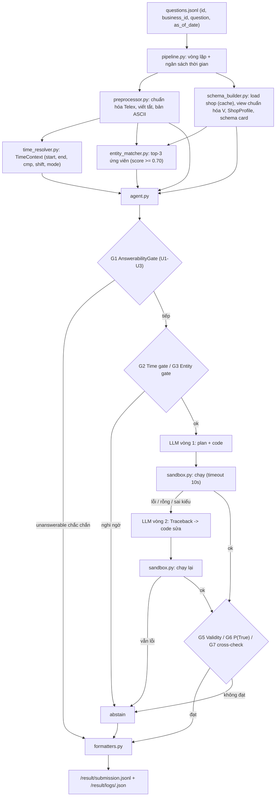
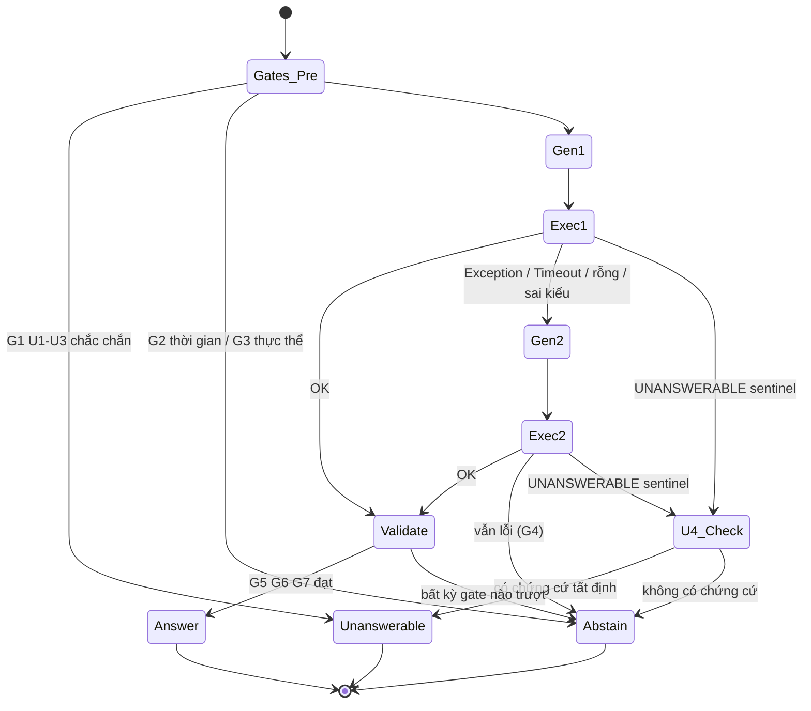
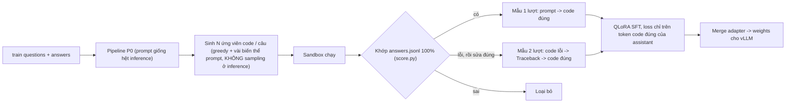

# DataMate v2 — BẢN THIẾT KẾ KIẾN TRÚC KỸ THUẬT (Technical Architecture Blueprint)

> **Phiên bản:** 2.0 · **Ngày lập:** 2026-11-14 · **Vai trò:** Chief AI Architect
> **Kiến trúc:** Schema-Aware Code-Act Agent + Sandbox Execution + Self-Correction (1 vòng) + Abstain/Unanswerable Gates
> **Model:** `Qwen/Qwen2.5-Coder-14B-Instruct` (~14.7B) — greedy, `temperature=0`, `seed=42`
> **Tài liệu đầu vào đã đọc:** `prompt model2.txt`, 5 bài báo (BIRD, Kadavath et al. "LMs (Mostly) Know What They Know", Self-Debug, OpenCodeInterpreter, Magicoder), `DATA MATE.docx`, `rulebook.md` (train + public_test), `calendar.csv`, `questions.jsonl`/`answers.jsonl`, toàn bộ mã nguồn cũ `bài làm nộp thử/datamate/*`.

> [!IMPORTANT]
> **Hạn chót nộp Docker là 23:59 ngày 16/11/2026 (GMT+7)** — còn khoảng 48 giờ tính từ lúc lập tài liệu này. Kỹ sư **bắt buộc** làm theo thứ tự ưu tiên ở [§6.1](#61-thứ-tự-triển-khai-bắt-buộc-p0--p1--p2): bản P0 (prompting + sandbox + gates, chưa fine-tune) phải chạy end-to-end trên train và public test **trước**, rồi mới làm SFT (P2).

---

## MỤC LỤC

0. [Tóm tắt điều hành & các phát hiện then chốt từ dữ liệu](#0-tóm-tắt-điều-hành--các-phát-hiện-then-chốt-từ-dữ-liệu)
1. [Nguyên tắc thiết kế & lý thuyết quyết định theo PA](#1-nguyên-tắc-thiết-kế--lý-thuyết-quyết-định-theo-pa)
2. [Kiến trúc tổng thể, cây thư mục, hợp đồng dữ liệu](#2-kiến-trúc-tổng-thể-cây-thư-mục-hợp-đồng-dữ-liệu)
3. [Đặc tả chi tiết từng module (I/O + interface)](#3-đặc-tả-chi-tiết-từng-module)
4. [Cơ chế Sandbox Execution, Self-Correction và chốt chặn Abstain](#4-cơ-chế-sandbox-execution-self-correction-và-chốt-chặn-abstain)
5. [Bộ nhận diện câu hỏi Unanswerable](#5-bộ-nhận-diện-câu-hỏi-unanswerable)
6. [Hướng dẫn cho Kỹ sư lập trình — Zero "-1" Checklist](#6-hướng-dẫn-cho-kỹ-sư-lập-trình--zero--1-checklist)
7. [Phụ lục: Prompt templates, SFT pipeline, danh sách bug code cũ](#7-phụ-lục)

---

## 0. TÓM TẮT ĐIỀU HÀNH & CÁC PHÁT HIỆN THEN CHỐT TỪ DỮ LIỆU

### 0.1 Quyết định kiến trúc cốt lõi

| # | Quyết định | Lý do |
|---|---|---|
| D1 | **LLM không bao giờ tính ngày, không bao giờ định dạng đáp án, không bao giờ tự quyết "unanswerable" một mình.** | Ngày: `time_resolver` tất định. Định dạng: `formatters` tất định. Unanswerable: cần chứng cứ tất định (capability/coverage) — một dự đoán sai = −1. |
| D2 | **LLM chỉ sinh mã Pandas** trên các **view chuẩn hóa** (`V['sales']`, `V['orders']`…) đã "nhúng sẵn" luật rulebook (trạng thái 4 loại, cờ `is_valid`, `qty_base`, `cust_key`…). | Đẩy độ khó (luật huỷ/trả, quy đổi, xác định khách) ra khỏi LLM → giảm lỗi logic im lặng (silent wrong) — loại lỗi nguy hiểm nhất vì không có Traceback để sửa. |
| D3 | **Thư viện helper trong sandbox** (`revenue_lines`, `top_k`, `pct`, `money`…) | Code ngắn, đúng luật tie-break/làm tròn; LLM chỉ "ghép" helper. |
| D4 | **Rulebook đọc động từ `/data/rulebook.md`** và đặt ở đầu system prompt (prefix cache). | `DATA MATE.docx`: *"the rulebook may differ between splits"*. Đã kiểm chứng: rulebook train ≠ public (xem §0.2-F6). |
| D5 | **Tối đa 2 lần sinh code** (Vòng 1 + 1 Self-Correction). Thất bại → `abstain`. | Self-Debug: phần lớn lợi ích đến từ lượt sửa đầu; tiết kiệm thời gian (giới hạn 6h). |
| D6 | **Nhiều chốt chặn (Gates G0–G7)** trước khi xuất đáp án; mặc định khi nghi ngờ là `abstain`. | PA: đáp án chỉ có lợi khi P(đúng) > 0.5. |
| D7 | Kế thừa code cũ có chọn lọc: `CalendarResolver`, `TimeParser` (port + vá lỗi), `DataLoader`, `BusinessAdapter`, `formatters`, `query_executors` (dùng làm **bộ kiểm chứng chéo**). | Code cũ đã xử lý được nhiều định dạng file bẩn; viết lại từ đầu là rủi ro lớn với deadline. |

### 0.2 Phát hiện từ dữ liệu (đã kiểm chứng bằng script, ảnh hưởng trực tiếp tới thiết kế)

| ID | Phát hiện | Hệ quả thiết kế |
|---|---|---|
| F1 | **262/1000 câu public test viết không dấu** (`"Rieng ngay hom nay doanh thu quan la bao nhieu?"`). | `time_resolver` chạy trên **văn bản ASCII (bỏ dấu)**; `entity_matcher` so khớp không dấu. |
| F2 | **76 câu public test dùng dạng `M/YY`** (`"8/26 tiền bán ca chiều"`, `"Tổng tiền bán tháng 10/25"`, `"So sánh 3/25, 4/25 và 5/25"`) — **train có 0 câu**. `TimeParser` cũ rơi về `default_today` → **sai hàng loạt**. | Thêm luật `M/YY` (§3.2, R13b). Đây là lỗi −1 lớn nhất của code cũ trên public test. |
| F3 | Câu Tết: `"tết năm nay so với tết năm ngoái"`, `"Tết Nguyên đán 2026"`, `"17 ngày trước Tết"`. Regex cũ `tết\s*(?:năm\s*)?(\d{4})?` không bắt được `năm ngoái`, không có so sánh Tết–Tết. | Viết lại luật Tết (R1) với 3 chế độ: đơn, so với trước Tết, Tết–Tết. |
| F4 | `calendar.csv` có cột `lunar_leap`; năm âm 2025 có **tháng 6 nhuận** (2025-07-25 → 2025-08-22). `CalendarResolver` cũ bỏ qua cột này → khóa `(2025,6,d)` bị ghi đè bằng ngày tháng nhuận. | Bỏ qua dòng nhuận khi dựng `lunar_to_date` (§3.2.1). |
| F5 | 70/3000 câu train là `unanswerable`. Nhóm chính: (a) **kỳ hỏi nằm hoàn toàn ngoài khoảng dữ liệu** (vd biz_103: tháng 2–3/2025 unanswerable, tháng 4/2025 trả lời được); (b) **thiếu bảng** (không có phiếu nhập → "tiền nhập hàng", không có tồn kho → "tồn kho", không có giá vốn trên dòng bán → "lãi gộp"); (c) **thuộc tính không được ghi** (địa chỉ/đường, giới tính, kênh bán, lý do trả/huỷ, liều dùng); (d) **câu hỏi chủ quan** về nhân viên (tận tâm, lễ phép, lành nghề, quý mến). | Bộ phát hiện 4 lớp U1–U4 (§5). Code cũ **abstain** ở nhóm (a) → mất trắng điểm. |
| F6 | Rulebook public test có thêm luật (topping, khách sộp, giờ cao điểm, mẹ & bé, sửa xe, điện thoại…) và **bỏ** một số luật train (tồn theo đơn vị lớn, giá nhập bình quân). | Không hard-code luật vào code; luật chuyên ngành đến LLM qua rulebook trong prompt. Chỉ các luật **chung** (§1, §2, §8, §9) được hiện thực tất định trong helper. |
| F7 | `weekday` trong calendar: 1 = Thứ Hai … 7 = Chủ Nhật (ISO). Python `date.weekday()`: 0 = Thứ Hai. | Mọi helper dùng `isoweekday()` khi tra calendar. |
| F8 | Cửa sổ Tết tính từ calendar: 2025: 2025-01-22→2025-02-07 (17 ngày); **2026: 2026-02-10→2026-02-26 (17 ngày), trước Tết 2026-01-24→2026-02-09**; 2027: 2027-01-30→2027-02-15. | Dùng làm unit test bắt buộc (§3.2.5). |
| F9 | Các tên thương hiệu trông giống Telex (`voucher`, `acyclovir`, `costar`, `dulux`, `powerflexx`, `huggies`, `petrolimex`) xuất hiện trong câu hỏi; lỗi Telex thật hiếm (~1–2%: `tieenf`, `dduowcj`, `rooif`, `naof`, `khoong`). | Bộ giải Telex **chỉ** áp cho token không có trong từ vựng shop và kết quả phải là âm tiết tiếng Việt hợp lệ (§3.1). |
| F10 | `DATA MATE.docx`: tổng tham số **mọi** model ≤ 15B (kể cả embedding/reranker); chạy offline; 2×RTX 5090; ≤ 6 giờ; `|PA_upload − PA_rerun| ≤ 0.03`; cấm logic theo `business_id`/`id`. | Qwen 14.7B + (tùy chọn) Vietnamese-SBERT ~0.135B = ~14.84B (phải khai báo). Không có thêm model nào khác. |

---

## 1. NGUYÊN TẮC THIẾT KẾ & LÝ THUYẾT QUYẾT ĐỊNH THEO PA

### 1.1 Toán học của chốt chặn

Với mỗi câu, gọi \(p\) là xác suất đáp án của hệ thống đúng. Kỳ vọng điểm:

$$
\mathbb{E}[\text{answer}] = p\cdot(+1) + (1-p)\cdot(-1) = 2p - 1, \qquad \mathbb{E}[\text{abstain}] = 0
$$

⇒ **Chỉ trả lời khi \(p > 0.5\)**. Tương tự, chỉ xuất `unanswerable` khi xác suất câu thật sự unanswerable \(q > 0.5\). Do private test có **loại hình kinh doanh mới** (distribution shift), ta dùng biên an toàn: ngưỡng hiệu chỉnh trên train sao cho độ chính xác của nhánh ≥ 0.80.

### 1.2 Ánh xạ bài báo → thành phần hệ thống

| Bài báo | Ý tưởng lấy về | Hiện thực ở |
|---|---|---|
| **BIRD** (*Can LLM Already Serve as a Database Interface?*) | Giá trị DB bẩn/nhiễu ("US$", ","), cần **external knowledge evidence** song song với schema; biểu diễn schema kèm **giá trị mẫu**. | `schema_builder`: schema card có kiểu dữ liệu + giá trị mẫu + mô tả README; "evidence" = các dòng rulebook liên quan được trích vào prompt. Làm sạch số/ngày trước khi đưa cho LLM. |
| **Self-Debug** (Chen et al.) | Vòng Generation → Execution → Feedback; *simple feedback* + *execution feedback* (traceback, kết quả) giúp sửa lỗi; lượt đầu mang lại phần lớn lợi ích. | `agent.run_with_self_correction`: đúng **1** vòng sửa, phản hồi = traceback rút gọn + gợi ý schema (cột có thật). |
| **OpenCodeInterpreter** | Hội thoại đa lượt có phản hồi thực thi, huấn luyện trên dữ liệu "code → lỗi → sửa". | Định dạng hội thoại retry **giống hệt** giữa inference và SFT (§7.2). |
| **Magicoder (OSS-Instruct)** + Execution-Filtered SFT | Sinh dữ liệu tổng hợp, **chỉ giữ mẫu chạy đúng**. | `tools/build_sft.py`: rejection sampling trên train, chỉ giữ code cho kết quả khớp `answers.jsonl` 100%. |
| **Kadavath et al.** (P(True), P(IK)) | Model lớn tự đánh giá khá hiệu chỉnh khi hỏi dạng True/False về đáp án đề xuất; P(True) có thể dùng làm ngưỡng từ chối. | Gate **G6** (tùy chọn): hỏi model "Đáp án đề xuất có đúng không? (A) Đúng (B) Sai", đọc logprob token "A"; abstain nếu < τ (τ hiệu chỉnh trên train). |

### 1.3 Bảy nguyên tắc bất biến (Invariants)

1. **I-1 Tất định:** cùng input ⇒ cùng output. Không `random`, không lặp qua `set` chưa sắp xếp, `PYTHONHASHSEED=0`, decode greedy.
2. **I-2 Không đoán:** mọi nhánh không chắc chắn kết thúc ở `abstain`.
3. **I-3 Một nguồn sự thật cho thời gian:** chỉ `time_resolver` sinh ngày; LLM chỉ đọc `T[...]`.
4. **I-4 Một nguồn sự thật cho định dạng:** chỉ `formatters.make_record` sinh dòng JSON.
5. **I-5 Mỗi `id` đúng một dòng** trong `submission.jsonl`, ghi tăng dần + `flush` (nếu bị ngắt do quá giờ, phần đã ghi vẫn được chấm).
6. **I-6 Không phụ thuộc định danh:** cấm `if business_id == ...`, cấm tra bảng theo `id` câu hỏi (vi phạm luật thi → bị loại).
7. **I-7 `/data` chỉ đọc:** file tạm ghi vào `/tmp/datamate/`.

---

## 2. KIẾN TRÚC TỔNG THỂ, CÂY THƯ MỤC, HỢP ĐỒNG DỮ LIỆU

### 2.1 Luồng xử lý



### 2.2 Cây thư mục bắt buộc

```text
second model/main_src/
├── ARCHITECTURE_BLUEPRINT.md        # tài liệu này
├── README.md                        # khai báo model, cách chạy (BTC yêu cầu)
├── Dockerfile
├── predict.sh                       # đọc /data, ghi /result/submission.jsonl + /result/logs/
├── requirements.txt                 # pin version (pandas, numpy, openpyxl, rapidfuzz, vllm, ...)
├── datamate2/
│   ├── __init__.py
│   ├── contracts.py                 # (phụ trợ) dataclass dùng chung, KHÔNG chứa logic
│   ├── preprocessor.py
│   ├── time_resolver.py
│   ├── entity_matcher.py
│   ├── schema_builder.py
│   ├── sandbox.py
│   ├── agent.py
│   ├── formatters.py
│   ├── pipeline.py
│   ├── legacy/                      # copy NGUYÊN VĂN code cũ, chỉ sửa import
│   │   ├── data_loader.py           #   <- bài làm nộp thử/datamate/data_loader.py
│   │   ├── business_adapter.py      #   <- .../business_adapter.py
│   │   └── query_executors.py       #   <- .../query_executors.py (bộ kiểm chứng chéo G7)
│   └── resources/
│       ├── abbreviations.json       # từ điển viết tắt / tiếng lóng
│       ├── concepts.json            # concept -> capability (§5.3)
│       ├── column_tags.json         # tag cột -> danh sách regex (kế thừa find_col cũ)
│       └── prompts/
│           ├── system.txt
│           ├── user.txt
│           ├── retry.txt
│           └── ptrue.txt
├── tests/                           # pytest — bắt buộc chạy xanh trước khi build Docker
│   ├── test_time_resolver.py
│   ├── test_formatters.py
│   ├── test_preprocessor.py
│   ├── test_sandbox.py
│   └── test_entity_matcher.py
├── tools/
│   ├── score.py                     # bộ chấm cục bộ mô phỏng §9 rulebook (dùng alias)
│   ├── calibrate.py                 # dò ngưỡng gate tối đa PA trên train
│   └── build_sft.py                 # Execution-Filtered SFT data
└── notebook.ipynb                   # chạy trên Colab L4 (dev)
```

### 2.3 Hợp đồng dữ liệu (`contracts.py`)

> Tất cả dataclass dùng `@dataclass(frozen=False)`; mọi trường ngày là **chuỗi ISO `YYYY-MM-DD`** (không dùng `datetime` để tránh lỗi serialize log).

```python
# datamate2/contracts.py
from dataclasses import dataclass, field
from typing import Any, Literal, Optional

AnswerType = Literal["number", "percent", "date", "boolean", "string", "list", "table",
                     "unanswerable", "abstain"]
ValueKind = Literal["money", "avg_money", "count", "quantity", "percent", "avg_other",
                    "hour", "day", "month", "name", "bool", "names", "numbers", "table", "pair"]

@dataclass
class QuestionItem:
    id: str
    business_id: str
    question: str
    as_of_date: str                      # "YYYY-MM-DD"

@dataclass
class NormalizedQuestion:
    raw: str                             # câu gốc, KHÔNG sửa
    text: str                            # có dấu, đã sửa Telex + mở rộng viết tắt, lowercase
    ascii: str                           # bản bỏ dấu của `text` (đ->d), lowercase, 1 khoảng trắng
    tokens: list[str]
    fixes: list[tuple[str, str]]         # [(token_gốc, token_sửa)] để log

@dataclass
class Period:
    start: Optional[str]                 # None khi mode == "snapshot" (tính từ đầu dữ liệu)
    end: Optional[str]
    label: str = ""                      # "2026-08", "tet_2026", ...

@dataclass
class TimeContext:
    mode: Literal["period", "snapshot", "multi", "none"]
    primary: Optional[Period]
    compare: Optional[Period]            # kỳ so sánh (nếu có)
    periods: list[Period] = field(default_factory=list)   # mode == "multi"
    shift: Optional[Literal["morning", "afternoon"]] = None
    compare_shift: Optional[Literal["morning", "afternoon"]] = None
    rule_id: str = "none"                # R1..R16 / fallback
    confidence: float = 0.0              # 1.0 = khớp luật tường minh; 0.0 = không tìm thấy
    has_time_cue: bool = False           # câu có từ chỉ thời gian hay không
    as_of: str = ""

@dataclass
class EntityCandidate:
    kind: Literal["item", "customer", "staff", "group", "supplier", "ingredient", "other"]
    code: str                            # mã (nếu không có mã: chính tên chuẩn)
    name: str                            # tên hiển thị như trong dữ liệu
    aliases: list[str]
    score: float                         # 0..1
    matched_span: str

@dataclass
class EntityResult:
    needs_entity: bool                   # câu có nhắc thực thể cụ thể không
    candidates: dict[str, list[EntityCandidate]]  # kind -> top-3
    best_score: float
    status: Literal["exact", "fuzzy", "ambiguous", "not_found", "not_needed"]

@dataclass
class AnswerSpec:
    type: AnswerType
    value_kind: ValueKind
    k: Optional[int] = None              # top-k
    n_values: Optional[int] = None       # list số theo thứ tự câu hỏi
    confidence: float = 0.0

@dataclass
class SandboxResult:
    ok: bool
    value: Any = None                    # final_result (đã chuyển sang kiểu Python thuần)
    error_type: Optional[str] = None     # "Timeout" | "KeyError" | "NoFinalResult" | ...
    traceback: Optional[str] = None      # đã rút gọn (<= 1200 ký tự)
    stdout: str = ""
    elapsed: float = 0.0
    unanswerable_reason: Optional[str] = None   # khi code gọi UNANSWERABLE(...)

@dataclass
class AgentDecision:
    type: AnswerType
    answer: Any = None
    value_kind: Optional[ValueKind] = None
    reason: str = ""
    gate: str = ""                       # gate quyết định cuối: "G1-U3", "G4-retry-fail", "OK"...
    trace: dict = field(default_factory=dict)   # toàn bộ dấu vết cho log
```

---

## 3. ĐẶC TẢ CHI TIẾT TỪNG MODULE

> Quy ước chung cho mọi module:
> - Hàm công khai **không bao giờ ném exception ra ngoài** trừ khi được ghi rõ; lỗi được trả qua giá trị (`None`, `status`, `ok=False`).
> - Mọi hàm có type hints đầy đủ, docstring ghi Input/Output.
> - Không dùng `print` để debug trong production; dùng `logging` (logger `datamate2.<module>`).

---

### 3.1 `preprocessor.py` — Chuẩn hóa câu hỏi

**Trách nhiệm:** Chuẩn hóa Unicode, sửa Telex gõ lỗi, mở rộng viết tắt/tiếng lóng, sinh bản ASCII. **Không** làm hỏng tên thực thể.

**Kế thừa:** toàn bộ các `re.sub` trong [question_parser.py L10–L38](file:///D:/ZALO%20AI%20CHALLENNGE/b%C3%A0i%20l%C3%A0m%20n%E1%BB%99p%20th%E1%BB%AD/datamate/question_parser.py#L10-L38) và [time_parser.py L22–L31](file:///D:/ZALO%20AI%20CHALLENNGE/b%C3%A0i%20l%C3%A0m%20n%E1%BB%99p%20th%E1%BB%AD/datamate/time_parser.py#L22-L31) được chuyển thành dữ liệu trong `resources/abbreviations.json`.

#### Interface

```python
class Preprocessor:
    def __init__(self, abbrev_path: str, protected_vocab: set[str] | None = None,
                 syllable_lexicon: set[str] | None = None) -> None: ...
    def set_shop_vocab(self, vocab: set[str]) -> None:
        """Input: tập token (lowercase, có dấu & không dấu) lấy từ tên hàng/khách/nhóm của shop.
        Tác dụng: các token này được BẢO VỆ, không bị sửa Telex/viết tắt."""
    def normalize(self, question: str) -> NormalizedQuestion:
        """Input: câu gốc. Output: NormalizedQuestion. Không ném exception."""

def strip_accents(s: str) -> str:
    """'Đơn hàng' -> 'Don hang'. Kế thừa query_executors.strip_accents (đ->d trước NFD)."""
def nfc(s: str) -> str: ...
def telex_decode_token(tok: str) -> str | None:
    """'tieenf'->'tiền', 'cuwar'->'cửa', 'dduowcj'->'được', 'khoong'->'không'.
    Trả None nếu token không phải mẫu Telex hợp lệ."""
```

#### Thuật toán `normalize` (thứ tự bắt buộc)

1. `nfc()` (Unicode NFC) → `lower()` → thay `\u00a0`, tab bằng khoảng trắng → gộp khoảng trắng.
2. Tách token bằng regex `r"\d+(?:[.,/:-]\d+)*|[^\W\d_]+|[^\s\w]"` (giữ nguyên số, ngày `8/26`, `12.500`).
3. **Sửa Telex** cho từng token `t` **chỉ khi đồng thời**:
   - `t` không thuộc `protected_vocab ∪ shop_vocab` (bảo vệ `voucher`, `costar`, `huggies`…),
   - `t` khớp mẫu Telex: chứa `aa|aw|ee|oo|ow|uw|dd` hoặc kết thúc bằng một trong `s f r x j` sau nguyên âm,
   - `telex_decode_token(t)` trả về âm tiết thuộc `syllable_lexicon` (tập âm tiết tiếng Việt dựng offline từ rulebook + README + giá trị dữ liệu + `questions.jsonl` train + danh sách âm tiết chuẩn ~7k).
4. **Mở rộng viết tắt** bằng bảng token→token (khớp nguyên token, có ngữ cảnh):

   | Token | Thay bằng | Điều kiện ngữ cảnh |
   |---|---|---|
   | `ko`, `k`, `hông`, `hok`, `khong` | `không` | `k` **không** đứng sau chữ số (`50k` là tiền) |
   | `sp` | `sản phẩm` | — |
   | `dc`, `đc`, `duoc`, `đươc` | `được` | — |
   | `dt`, `dthu`, `d thu`, `revenue` | `doanh thu` | `dt` không đứng trước số điện thoại |
   | `nv` | `nhân viên` | — |
   | `kh` | `khách hàng` | — |
   | `bn`, `bnhiu`, `bnhieu`, `bnh`, `bao nhiu`, `nhiêu` (đứng sau `là`/`được`/`hết`) | `bao nhiêu` | — |
   | `hnay`, `hom ni`, `hôm ni`, `bữa nay`, `bua nay` | `hôm nay` | — |
   | `hqua`, `bữa qua`, `bua qua` | `hôm qua` | — |
   | `trc` | `trước` | — |
   | `th` + số | `tháng` | `th` đứng trước số hoặc `trước`/`này` |
   | `vs` | `so với` | — |
   | `z`, `v`, `zậy` (cuối câu) | `vậy` | chỉ ở cuối câu |
   | `j` (cuối câu) | `gì` | chỉ ở cuối câu |
   | `nhìu`, `nhiu` | `nhiều` | — |
   | `mik`, `mk` | `mình` | — |
   | `ncc` | `nhà cung cấp` | — |
   | `sl` | `số lượng` | — |
   | `hđ` | `hoá đơn` | — |
   | `đh` | `đơn hàng` | — |
   | `total` | `tổng cộng` | — |
   | `<số>k` | giữ nguyên chuỗi, thêm token chuẩn `<số*1000>` vào `fixes` | — |
   | `<số>tr`, `<số> triệu` | `<số*1_000_000>` | — |

5. `text` = ghép token; `ascii` = `strip_accents(text)`.
6. **Không bao giờ** sửa token nằm trong cụm khớp tên thực thể (entity_matcher chạy trên **cả** `raw` và `text`).

#### Ví dụ kiểm thử bắt buộc (`tests/test_preprocessor.py`)

| Input | `text` mong đợi (rút gọn) | `ascii` |
|---|---|---|
| `coi giumf tieenf bán Trà vải (L) tháng 3/2025` | `coi giùm tiền bán trà vải (l) tháng 3/2025` | `coi gium tien ban tra vai (l) thang 3/2025` |
| `check giùm tháng 2/2025 ai là khách mua nhìu lần nhất` | `... nhiều lần nhất` | — |
| `dthu thang 2/2025 bnhiu` | `doanh thu tháng 2/2025 bao nhiêu` | `doanh thu thang 2/2025 bao nhieu` |
| `Voucher shop tháng này` | `voucher` **giữ nguyên** | — |
| `bán 50k` | `50k` giữ nguyên | — |

---

### 3.2 `time_resolver.py` — Phân giải thời gian tất định

**Trách nhiệm:** Từ `NormalizedQuestion.ascii` + `as_of_date` + `calendar.csv` → `TimeContext`. **Đây là module có tỉ trọng điểm lớn nhất** (gần như mọi câu đều có kỳ thời gian).

**Kế thừa:** [calendar_resolver.py](file:///D:/ZALO%20AI%20CHALLENNGE/b%C3%A0i%20l%C3%A0m%20n%E1%BB%99p%20th%E1%BB%AD/datamate/calendar_resolver.py) (nguyên logic `get_tet_range`) và [time_parser.py](file:///D:/ZALO%20AI%20CHALLENNGE/b%C3%A0i%20l%C3%A0m%20n%E1%BB%99p%20th%E1%BB%AD/datamate/time_parser.py) (thứ tự luật 1→13). Port sang regex ASCII và vá 9 lỗi liệt kê ở §3.2.4.

#### 3.2.1 `CalendarResolver` (kế thừa + vá lỗi tháng nhuận)

```python
# datamate2/time_resolver.py  (phần 1 — kế thừa calendar_resolver.py)
import csv
from datetime import date, datetime, timedelta

class CalendarResolver:
    """Kế thừa nguyên văn logic từ bài làm nộp thử/datamate/calendar_resolver.py.
    VÁ LỖI: bỏ qua dòng lunar_leap=true khi dựng lunar_to_date (tránh tháng nhuận ghi đè tháng thường)."""

    def __init__(self, calendar_path: str | None = None) -> None:
        self.date_to_lunar: dict[str, tuple[int, int, int]] = {}
        self.lunar_to_date: dict[tuple[int, int, int], str] = {}   # (lunar_year, lunar_month, lunar_day) -> 'YYYY-MM-DD'
        self.date_to_info: dict[str, dict] = {}
        self.min_date: str | None = None
        self.max_date: str | None = None
        if calendar_path:
            self.load_calendar(calendar_path)

    def load_calendar(self, calendar_path: str) -> None:
        with open(calendar_path, mode="r", encoding="utf-8") as f:
            for row in csv.DictReader(f):
                d_str = row["date"].strip()
                l_day, l_month, l_year = int(row["lunar_day"]), int(row["lunar_month"]), int(row["lunar_year"])
                is_leap = str(row.get("lunar_leap", "false")).strip().lower() == "true"
                w_day = int(row["weekday"])                     # 1 = Thứ Hai ... 7 = Chủ Nhật (ISO)
                holiday = (row.get("holiday") or "").strip()
                self.date_to_lunar[d_str] = (l_day, l_month, l_year)
                if not is_leap:                                  # <-- VÁ LỖI F4
                    self.lunar_to_date[(l_year, l_month, l_day)] = d_str
                self.date_to_info[d_str] = {"weekday": w_day, "lunar": (l_day, l_month, l_year),
                                            "leap": is_leap, "holiday": holiday}
        ds = sorted(self.date_to_info)
        self.min_date, self.max_date = (ds[0], ds[-1]) if ds else (None, None)

    def get_tet_range(self, tet_year: int) -> tuple[str | None, str | None, str | None, str | None]:
        """Rulebook §2 'Tết năm Y': từ ngày dương của 23 tháng Chạp (năm âm Y-1)
        đến hết ngày dương của mùng 10 tháng Giêng (năm âm Y).
        'So với trước Tết' = cùng số ngày ngay trước 23 tháng Chạp.
        Output: (start, end, before_start, before_end) hoặc (None,)*4 nếu ngoài lịch."""
        start_date = self.lunar_to_date.get((tet_year - 1, 12, 23))
        end_date = self.lunar_to_date.get((tet_year, 1, 10))
        if not start_date or not end_date:
            return None, None, None, None
        d_start = datetime.strptime(start_date, "%Y-%m-%d").date()
        d_end = datetime.strptime(end_date, "%Y-%m-%d").date()
        num_days = (d_end - d_start).days + 1
        d_before_end = d_start - timedelta(days=1)
        d_before_start = d_before_end - timedelta(days=num_days - 1)
        return start_date, end_date, d_before_start.isoformat(), d_before_end.isoformat()

    def get_before_tet_n_days(self, tet_year: int, n: int) -> tuple[str | None, str | None]:
        """MỚI: 'N ngày (ngay) trước Tết' khi N khác độ dài cửa sổ Tết."""
        s, _, _, _ = self.get_tet_range(tet_year)
        if not s:
            return None, None
        d_s = date.fromisoformat(s)
        return (d_s - timedelta(days=n)).isoformat(), (d_s - timedelta(days=1)).isoformat()

    def weekday_iso(self, d: str) -> int:
        """1..7; fallback date.isoweekday() nếu ngày ngoài lịch."""
        info = self.date_to_info.get(d)
        return info["weekday"] if info else date.fromisoformat(d).isoweekday()

    def count_weekday(self, start: str, end: str, iso_weekday: int) -> int:
        """Rulebook §2 'Trung bình mỗi ngày thứ X của kỳ': đếm số ngày thứ X trong [start, end],
        kể cả ngày không có đơn."""
        d, e, n = date.fromisoformat(start), date.fromisoformat(end), 0
        while d <= e:
            n += d.isoweekday() == iso_weekday
            d += timedelta(days=1)
        return n
```

#### 3.2.2 `TimeResolver` — interface

```python
class TimeResolver:
    def __init__(self, cal: CalendarResolver) -> None: ...

    def resolve(self, nq: NormalizedQuestion, as_of: str) -> TimeContext:
        """Input: câu đã chuẩn hóa + as_of 'YYYY-MM-DD'.
        Output: TimeContext. Không ném exception (lỗi nội bộ -> mode='none', confidence=0)."""

    # ---- các hàm con công khai (để test riêng) ----
    def resolve_month(self, m: int, y: int | None, as_of: date) -> Period: ...
    def resolve_quarter(self, q: int, y: int | None, as_of: date) -> Period: ...
    def resolve_tet(self, ascii_text: str, as_of: date) -> TimeContext | None: ...
    def resolve_compare(self, ascii_text: str, primary: Period, rule_id: str, as_of: date) -> Period | None: ...
    def detect_shift(self, ascii_text: str) -> tuple[str | None, str | None]: ...
    def has_time_cue(self, ascii_text: str) -> bool: ...
```

#### 3.2.3 Bảng luật theo thứ tự ưu tiên (regex trên văn bản **ASCII**)

> Giữ **nguyên thứ tự** luật của `TimeParser.parse_time_period` cũ (Tết → khoảng ngày → đầu năm → hôm nay → hôm qua → N ngày → ngày cụ thể → tuần này → tuần trước → quý → tháng này → tháng trước → tháng M/Y), chèn các luật mới (đánh dấu ★) vào vị trí ghi trong bảng. Luật đầu tiên khớp sẽ thắng.

| Thứ tự | ID | Mẫu (ASCII, minh họa) | Kết quả `primary` | `compare` mặc định | Nguồn |
|---|---|---|---|---|---|
| 1 | R1 | `\btet\b` **không** theo sau `duong lich`/`tay` | Cửa sổ Tết năm Y (§3.2.4-B1) | xem chế độ Tết | cũ #1 + vá |
| 2 | R2 | `tu (ngay )?D/M(/Y)? (den\|toi\|-) (het )?(ngay )?D/M(/Y)?` | [D1, D2] (gồm cả 2 đầu) | — | cũ #2 + vá năm 2 số, thiếu năm |
| 3 | R2b★ | `tu thang M/Y (den\|toi\|qua) thang M2/Y2` hoặc liệt kê `M/Y, M/Y va M/Y`, `3/25, 4/25 va 5/25` | `mode="multi"`, `periods=[tháng...]` | — | mới (F2) |
| 4 | R2c★ | `(\d+) thang lien nhau ket thuc o thang M/Y` | `mode="multi"`, N tháng, thứ tự cũ→mới | — | từ question_parser cũ #0b |
| 5 | R3 | `tu dau nam`, `tu (ngay )?0?1/0?1`, `dau nam (toi\|den) nay` | [01/01/năm as_of, as_of] | cùng kỳ năm trước nếu có `cung ky` | cũ #3/#10 |
| 6 | R3b★ | `tu dau thang (nay)?`, `thang nay (toi\|den) (het )?hom nay` | = R12 | = R12 | mới |
| 7 | R4★ | `(den het\|tinh den( het)?\|cuoi ngay\|het) (ngay )?(D/M/Y\|hom nay)` và **không** có `tu ...` đứng trước | `mode="snapshot"`, `start=None`, `end=X` | — | mới (Rulebook §2 "Đến hết ngày X") |
| 8 | R5 | `hom nay` (loại trừ `tu dau`, `tinh den`, `den het`, `thang nay`, `tuan nay`) | [as_of, as_of] | hôm qua | cũ #4 |
| 9 | R6 | `hom qua`; ★`hom kia` | [as_of−1] / [as_of−2] | ngày liền trước | cũ #5 + mới |
| 10 | R7 | `(\d+) ngay gan (nhat\|day)`; ★`(\d+) tuan gan nhat` (7N ngày) | [as_of−N+1, as_of] | N ngày liền trước | cũ #6 |
| 11 | R8 | `(ngay )?D/M/YYYY` | [D, D] | ngày liền trước | cũ #7 |
| 12 | R8b | `(ngay\|hom) D/M` (không có năm) | năm theo luật "không sau hôm nay" | — | cũ #7b |
| 13 | R9 | `tuan nay` | [Thứ Hai tuần chứa as_of, as_of] | ★cùng số ngày tuần trước | cũ #8 |
| 14 | R10 | `tuan (truoc\|roi)` | [Thứ Hai, Chủ Nhật] tuần liền trước | tuần trước nữa | cũ #9 |
| 15 | R11 | `quy (\d)( nam\| \|/)?(\d{2,4})?`; ★`quy nay`, `quy truoc` | cả quý | quý liền trước | cũ #11 (giữ: quý **trước** tháng) |
| 16 | R12 | `thang nay` | [01/tháng as_of, as_of] | [01/tháng trước, min(ngày as_of, ngày cuối tháng trước)] | cũ #12 |
| 17 | R12b | `thang (truoc\|roi)` (không kèm `thang \d`, không phải `so voi thang truoc`) | cả tháng trước | tháng trước nữa | cũ #12b |
| 18 | R13 | `thang M( nam\|/\|-)?Y?` | cả tháng (năm theo luật) | tháng liền trước (hoặc kỳ thứ 2 sau `so voi`) | cũ #13 |
| 19 | R13b★ | `(?<![\d/])(1[0-2]\|0?[1-9])/(2[4-7])(?![\d/])` (M/YY, YY ∈ 24..27) | cả tháng M/20YY | như R13 | **mới (F2)** |
| 20 | R14★ | `nam (20\d\d)`, `nam nay`, `nam (ngoai\|truoc\|trc)` (không đi kèm tháng/quý/Tết) | cả năm (năm nay: đến as_of) | năm liền trước | mới |
| — | FB | không khớp luật nào | `mode="none"`, `confidence=0.0`, `primary=None` | — | **thay cho `default_today` cũ** |

**Luật năm cho tháng/quý/ngày không ghi năm** (Rulebook §2): *"của năm nay nếu không sau hôm nay; sau hôm nay thì của năm trước"*:

```python
def _year_for_month(m: int, as_of: date) -> int:
    return as_of.year - 1 if m > as_of.month else as_of.year          # giữ nguyên logic cũ (đã đúng)

def _year_for_quarter(q: int, as_of: date) -> int:
    curr_q = (as_of.month - 1) // 3 + 1
    return as_of.year - 1 if q > curr_q else as_of.year                # giữ nguyên logic cũ

def _year_for_day_month(d: int, m: int, as_of: date) -> int:
    return as_of.year if (m, d) <= (as_of.month, as_of.day) else as_of.year - 1   # cũ #7b
```

**Kỳ so sánh (`resolve_compare`)** — áp sau khi có `primary`, theo thứ tự:

1. Có kỳ thời gian thứ hai tường minh sau `so voi|so vs|voi|so` → kỳ đó.
2. `cung ky nam (truoc|ngoai)` → `primary` lùi 1 năm (tháng → cả tháng năm trước; `thang nay` → cùng số ngày của tháng đó năm trước).
3. `cung ky thang truoc`, `so voi thang (truoc|lien truoc)` với R12 → compare mặc định của R12 (*cùng số ngày*, Rulebook §2).
4. `truoc tet`, `(\d+) ngay (ngay )?truoc tet` → `get_tet_range()[2:]` hoặc `get_before_tet_n_days(Y, N)`.
5. `tet nam nay so voi tet nam (ngoai|truoc)` → Tết(Y−1).
6. Còn lại → compare mặc định của luật (bảng trên).

**Ca (`detect_shift`)** — Rulebook §2: ca sáng 06:00–13:59, ca chiều 14:00–21:59.
`ca sang` → `morning`; `ca chieu` → `afternoon`. Câu "*ca chiều hơn hay kém ca sáng*" → `shift="afternoon"`, `compare_shift="morning"` (*mốc là ca sáng* — kỳ so sánh là ca sáng).

**`has_time_cue`**: True nếu ASCII chứa một trong: `ngay|hom|tuan|thang|quy|nam|tet|\d{1,2}/\d{2,4}|gan nhat|dau nam|dau thang|den het|tinh den|cuoi ngay|ca sang|ca chieu`. Dùng cho Gate G2.

#### 3.2.4 Các lỗi của code cũ PHẢI vá (không được kế thừa lỗi)

| # | Lỗi trong code cũ | Vá |
|---|---|---|
| B1 | Tết: `tết năm ngoái` → lấy `as_of.year` (sai). Năm 4 chữ số đứng sau `âm lịch`/`Nguyên đán` chỉ đúng do trùng hợp. Không có "Tết–Tết". Không có Tết mặc định khi `as_of` trước cửa sổ Tết. | Tìm năm trong 25 ký tự sau `tet`: 4 chữ số → Y; `nam nay` → as_of.year; `nam (ngoai\|truoc\|trc)` → as_of.year−1. Không có năm: Y = as_of.year nếu `start(Tết Y) ≤ as_of` ngược lại Y−1. Thêm chế độ so sánh (mục 4–5 của `resolve_compare`). |
| B2 | `Tết Dương lịch` bị hiểu là Tết âm. | Loại trừ `tet duong lich`, `tet tay` (dùng cột `holiday` = `Tết Dương lịch` → ngày 01/01). |
| B3 | Không có dạng `M/YY` → rơi vào `default_today`. | R13b. |
| B4 | Fallback `default_today` âm thầm → trả lời sai kỳ. | Fallback `mode="none"`, `confidence=0` → Gate G2 quyết định (abstain nếu câu có tín hiệu thời gian hoặc intent cần kỳ). |
| B5 | "Đến hết ngày X" (số còn lại: nợ, tồn) bị hiểu là chỉ ngày X. | R4 `mode="snapshot"`. |
| B6 | Không có cả năm (`năm 2025`, `năm ngoái`). | R14. |
| B7 | Khoảng ngày `từ D/M đến D/M` không năm → không khớp. | R2 áp `_year_for_day_month` cho mỗi đầu; nếu start > end thì start lùi 1 năm. |
| B8 | `tháng trước` bị chặn khi câu có `tháng \d` ở bất kỳ đâu. | Giữ điều kiện cũ nhưng chỉ xét `thang \d` **không** nằm trong cụm so sánh. |
| B9 | Danh sách nhiều tháng (`3/25, 4/25 và 5/25`, `3 tháng 12/2025, 1/2026, 2/2026`) nằm rải rác trong `question_parser`. | Gom vào R2b `mode="multi"`. |

#### 3.2.5 Unit test bắt buộc (`tests/test_time_resolver.py`) — giá trị đã tính từ `calendar.csv`

| Câu (sau chuẩn hóa) | as_of | primary | compare | mode/shift |
|---|---|---|---|---|
| `dịp tết 2026 quán có doanh thu bao nhiêu` | 2026-08-21 | 2026-02-10 → 2026-02-26 | — | period |
| `dịp tết âm lịch 2026 so với 17 ngày trước tết` | 2026-08-08 | 2026-02-10 → 2026-02-26 | 2026-01-24 → 2026-02-09 | period |
| `doanh thu tết năm nay so với tết năm ngoái` | 2026-06-28 | 2026-02-10 → 2026-02-26 | 2025-01-22 → 2025-02-07 | period |
| `dịp tết bán chạy nhất` | 2026-01-10 | **2025-01-22 → 2025-02-07** (Tết 2026 chưa bắt đầu) | — | period |
| `8/26 tiền bán ca chiều là bao nhiêu` | 2026-09-19 | 2026-08-01 → 2026-08-31 | — | shift=afternoon |
| `tổng tiền bán tháng 10/25` | 2026-05-10 | 2025-10-01 → 2025-10-31 | — | period |
| `so sánh 3/25, 4/25 và 5/25 tháng nào bán nhiều tiền nhất` | 2026-07-08 | — | — | multi: 2025-03, 2025-04, 2025-05 |
| `cho tôi biết doanh thu tuần này` | 2025-11-16 (CN) | 2025-11-10 → 2025-11-16 | — | period |
| `tuần rồi` | 2025-11-16 | 2025-11-03 → 2025-11-09 | — | period |
| `tháng này so với cùng kỳ tháng trước` | 2025-03-31 | 2025-03-01 → 2025-03-31 | 2025-02-01 → 2025-02-28 | period |
| `30 ngày gần nhất` | 2026-06-05 | 2026-05-07 → 2026-06-05 | — | period |
| `tháng 11` | 2026-05-24 | 2025-11-01 → 2025-11-30 | — | period |
| `quý 2/2026` | 2026-07-09 | 2026-04-01 → 2026-06-30 | 2026-01-01 → 2026-03-31 | period |
| `tính đến hết ngày 12/07/2025, 5 khách nợ nhiều nhất` | 2026-07-09 | start=None, end=2025-07-12 | — | snapshot |
| `doanh thu bao nhiêu` | 2026-01-01 | None | — | none (confidence 0) |
| `từ 25/06/2026 đến hết 01/07/2026` | 2026-07-09 | 2026-06-25 → 2026-07-01 | — | period |

---

### 3.3 `entity_matcher.py` — Liên kết thực thể (RapidFuzz + tùy chọn SBERT)

**Trách nhiệm:** Tìm sản phẩm/khách/nhân viên/nhóm hàng/nhà cung cấp/hoạt chất được nhắc trong câu; trả top-3 ứng viên kèm điểm.

**Kế thừa:** `match_item_rows` + `strip_accents` + `normalize_query_str` từ [query_executors.py L27–L119](file:///D:/ZALO%20AI%20CHALLENNGE/b%C3%A0i%20l%C3%A0m%20n%E1%BB%99p%20th%E1%BB%AD/datamate/query_executors.py#L27-L119) (exact → substring → token → không dấu) làm **tầng 1**.

#### Interface

```python
@dataclass
class EntityIndex:
    kind: str
    codes: list[str]
    names: list[str]                 # tên hiển thị (spelling phổ biến nhất trong dữ liệu bán)
    aliases: list[list[str]]         # mọi cách viết trong dữ liệu + mã
    norm: list[str]                  # strip_accents(lower(name)), 1 khoảng trắng
    embeddings: "np.ndarray | None"  # chỉ khi bật SBERT

class EntityMatcher:
    def __init__(self, threshold: float = 0.70, top_k: int = 3, use_sbert: bool = False,
                 sbert_path: str | None = None) -> None: ...
    def build_index(self, profile: "ShopProfile", views: dict[str, "pd.DataFrame"]) -> dict[str, EntityIndex]:
        """Input: hồ sơ + view chuẩn hóa của 1 shop. Output: index theo kind. Gọi 1 lần/shop (cache)."""
    def match(self, nq: NormalizedQuestion, index: dict[str, EntityIndex],
              kinds: list[str] | None = None) -> EntityResult:
        """Input: câu đã chuẩn hóa. Output: EntityResult (top-3 mỗi kind)."""
    def shop_vocab(self, index: dict[str, EntityIndex]) -> set[str]:
        """Tập token có dấu + không dấu của mọi tên -> đưa cho Preprocessor.set_shop_vocab."""
```

#### Thuật toán `match`

1. **Mask thời gian & từ chức năng:** xóa khỏi `ascii` các cụm đã khớp bởi `time_resolver` và các từ hỏi (`bao nhieu`, `la`, `cua`, `ban duoc`, `doanh thu`, `thang`...) → `residual`.
2. **Tầng 1 — Exact/substring không dấu** (kế thừa `match_item_rows`): nếu `norm[i]` là chuỗi con của `ascii` câu ⇒ `score=1.0`. Nếu nhiều tên cùng là chuỗi con ⇒ **giữ tên dài nhất** và loại các tên là chuỗi con của tên đó (vd. câu có `bia tiger bac lon` ⇒ loại `bia tiger lon`).
3. **Tầng 2 — Fuzzy n-gram** (chỉ khi tầng 1 không có): sinh mọi n-gram từ `residual` (n = 1..10 token), với mỗi ứng viên tính

   $$
   s = \max_{g}\Big(0.5\cdot \text{token\_set\_ratio}(g, \text{name}) + 0.5\cdot \text{ratio}(g, \text{name})\Big)/100
   $$

   (`token_set_ratio` một mình cho 100 khi chuỗi con — gây hòa giả; trộn `ratio` để phạt chênh độ dài). Dùng `rapidfuzz.process.extract` với `processor=None` (đã chuẩn hóa sẵn).
4. **Tầng 3 — SBERT (tùy chọn, mặc định TẮT):** nếu bật, `s_final = 0.6·s_fuzzy + 0.4·cos(emb(residual), emb(name))`. Model `keepitreal/vietnamese-sbert` (~135M) → **phải khai báo** trong README (tổng 14.7B + 0.135B ≈ 14.84B ≤ 15B).
5. Sắp xếp `(-score, len_diff, code)` (tất định), lấy top-3.
6. Trạng thái:
   - `best ≥ 0.95` hoặc tầng 1 → `exact`;
   - `0.70 ≤ best < 0.95` → `fuzzy` (đưa top-3 vào prompt cho LLM chọn);
   - top-1 và top-2 cách nhau < 0.03 và cả hai < 0.95 → `ambiguous`;
   - `best < 0.70` → `not_found`.
7. `needs_entity` = True khi câu khớp mẫu nhắc thực thể: `(mat hang|san pham|hang|mon|thuoc|khach|nhan vien|tho|nhom|nha cung cap|hoat chat) <tên>`, hoặc phần `residual` còn ≥ 2 token nội dung sau khi loại từ chức năng, hoặc tầng 1/2 có `best ≥ 0.70`.

> [!WARNING]
> `not_found` **không** tự động là `unanswerable`. Rulebook §7 chỉ coi là unanswerable khi *"shop không ghi loại thông tin câu hỏi cần"*. Một mặt hàng không tìm thấy có thể do lỗi khớp ⇒ **abstain** (Gate G3). Chỉ đổi chính sách nếu `tools/calibrate.py` cho thấy precision ≥ 0.8 trên train.

---

### 3.4 `schema_builder.py` — Nạp dữ liệu, view chuẩn hóa, hồ sơ năng lực, schema card

**Trách nhiệm:**
1. Nạp mọi file của shop thành `dfs` sạch (kế thừa `DataLoader`).
2. Dựng **view chuẩn hóa** `V` (kế thừa + mở rộng `BusinessAdapter`).
3. Dựng `ShopProfile` (capabilities + khoảng ngày) phục vụ Unanswerable Gate.
4. Sinh **schema card** (văn bản cho prompt) theo kiểu BIRD: cột + kiểu + giá trị mẫu + mô tả README.
5. Trích rulebook liên quan (evidence).

**Kế thừa:**
- [data_loader.py](file:///D:/ZALO%20AI%20CHALLENNGE/b%C3%A0i%20l%C3%A0m%20n%E1%BB%99p%20th%E1%BB%AD/datamate/data_loader.py): `clean_currency_str`, `parse_date_str`, `DataLoader` (dò header, xóa dòng tổng, ffill ô gộp, gộp sheet theo tháng, đọc sqlite, parse README quy đổi + `max_data_date`).
- [business_adapter.py](file:///D:/ZALO%20AI%20CHALLENNGE/b%C3%A0i%20l%C3%A0m%20n%E1%BB%99p%20th%E1%BB%AD/datamate/business_adapter.py): `find_col` + toàn bộ danh sách regex cột → chuyển vào `resources/column_tags.json`; `extract_*`, `link_orders_and_items`, `calc_base_qty`.

#### 3.4.1 Interface

```python
@dataclass
class TableCard:
    name: str                        # khóa trong dfs, vd "So_chi_tiet_ban_hang.xlsx" hoặc "DuLieuXuat.xlsx:DanhSachThuoc"
    n_rows: int
    columns: list[dict]              # [{"name","dtype","tag","null_pct","samples":[...<=5], "readme_desc"}]
    date_min: str | None
    date_max: str | None

@dataclass
class ShopProfile:
    business_id: str
    readme: str                      # nguyên văn README.md
    readme_max_date: str | None      # "Dữ liệu có đến hết dd/mm/yyyy"
    data_min_date: dict[str, str]    # theo fact: {"sales": ..., "imports": ..., "payments": ...}
    data_max_date: dict[str, str]
    capabilities: dict[str, bool]    # §5.2
    empty_columns: list[str]         # cột "trống, không có dữ liệu" (README) hoặc 100% null
    has_customer_code: bool          # Rulebook §3 Xác định khách
    tables: list[TableCard]
    unit_conversions: dict[str, dict[str, float]]
    warnings: list[str]              # lỗi parse, % ô số không đọc được...

class ShopStore:
    """Cache theo business_id. Nạp lười (lazy) lần đầu được hỏi."""
    def __init__(self, data_root: str, cal: "CalendarResolver") -> None: ...
    def get(self, business_id: str) -> "ShopBundle | None":
        """Output: ShopBundle(profile, dfs, views, schema_card_text, entity_index) hoặc None nếu thiếu thư mục."""

@dataclass
class ShopBundle:
    profile: ShopProfile
    dfs: dict[str, "pd.DataFrame"]       # bảng gốc đã làm sạch (raw-clean)
    views: dict[str, "pd.DataFrame"]     # V chuẩn hóa
    schema_card: str                     # văn bản cho prompt (<= ~2.5k token)
    entity_index: dict[str, "EntityIndex"]

def build_views(loader: "DataLoader", adapter: "BusinessAdapter", profile: ShopProfile) -> dict[str, "pd.DataFrame"]: ...
def build_profile(business_id: str, loader, adapter, views) -> ShopProfile: ...
def render_schema_card(profile: ShopProfile, views: dict, dfs: dict, max_tokens: int = 2500) -> str: ...

class RulebookIndex:
    def __init__(self, rulebook_path: str) -> None:
        """Đọc /data/rulebook.md của SPLIT ĐANG CHẠY (không dùng bản copy)."""
    def full_text(self) -> str: ...
    def retrieve(self, nq: NormalizedQuestion, k: int = 8) -> list[str]:
        """Trả k dòng bảng luật liên quan nhất (BM25 trên ASCII) + luôn kèm dòng §9 của type dự kiến."""
```

#### 3.4.2 View chuẩn hóa `V` (hợp đồng cột — LLM chỉ được dựa vào các cột này)

> Cột `date` luôn là `datetime64[ns]` đã chuẩn hóa về 00:00; `dt` là thời điểm đầy đủ (nếu có giờ). So sánh với chuỗi `'YYYY-MM-DD'` hợp lệ trong pandas.

**`V['sales']`** — một dòng = một dòng hàng (hoặc một đơn nếu shop chỉ có bảng đơn: `is_order_level=True`):

| Cột | Kiểu | Ý nghĩa / luật áp dụng |
|---|---|---|
| `order_id` | str | Mã đơn; shop không có mã → `auto_<i>` (mỗi dòng 1 lần ghi — Rulebook §8) |
| `date`, `dt`, `hour` | datetime64 / datetime64 / Int64 | Ngày **đặt** (Rulebook §1). `hour` từ giờ tạo đơn (ca, giờ cao điểm) |
| `status_raw` | str | Trạng thái/ghi chú gốc |
| `status` | {`hoan_thanh`,`huy`,`tra_hang`,`dang_giao`} | Rulebook §8: đúng 1 trong 4. Không có cột trạng thái → đọc Ghi chú; ghi chú không nhắc → `hoan_thanh`. Đơn có **bất kỳ** dòng trả/SL âm/xuất hiện ở bảng trả hàng → `tra_hang` cho **cả đơn** |
| `is_valid` | bool | `status ∉ {huy, tra_hang}` — dùng cho doanh thu, số đơn, bán chạy |
| `item_code`, `item_name`, `item_group` | str | Tên theo dữ liệu; mã ưu tiên từ danh mục |
| `is_service_fee` | bool | Dòng "Phí phục vụ" (không phải mặt hàng, **vẫn** tính doanh thu) |
| `unit`, `qty`, `qty_base`, `base_unit` | str/float/float/str | `qty_base` = quy về đơn vị cơ bản (bảng quy đổi/README; không có dòng quy đổi → hệ số 1) |
| `unit_price`, `amount` | float | `amount` = thành tiền dòng **sau** giảm giá dòng |
| `line_cost` | float/NaN | `qty × giá vốn ghi trên dòng bán` (Rulebook §5). NaN nếu shop không có |
| `cust_key`, `cust_name`, `cust_code` | str | Rulebook §3: có mã khách → `cust_key=mã`; không mã → tên chuẩn hóa (bỏ khác biệt cách viết: lower, bỏ dấu câu, gộp khoảng trắng). Khách lẻ/vãng lai → `""` |
| `staff` | str | Nhân viên/thợ (nếu có) |
| `payment_method`, `channel`, `cust_group` | str | Nếu có |
| `_src` | str | Bảng nguồn (truy vết) |

**`V['orders']`** — một dòng = một đơn: `order_id, date, dt, hour, status, is_valid, cust_key, cust_name, staff, payment_method, channel, revenue` (= Σ `amount` các dòng), `total_payable` (khách phải trả cả đơn, gồm ship, sau giảm cả đơn), `paid_at_purchase`, `debt_flag`, `n_lines`.
**`V['products']`**: `item_code, item_name, item_group, base_unit, price, catalog_cost, is_prescription, active_ingredient, size_number, ...` (cột có thì mới tạo).
**`V['conversions']`**: `item_code, item_name, unit, factor_to_base`.
**`V['imports']`**: `import_id, date, status, is_cancelled, supplier, item_code, item_name, unit, qty, qty_base, unit_price, line_amount, receipt_total, lot, expiry_date`.
**`V['inventory']`**: `item_code, item_name, qty_base, as_of_date` (tồn cuối ngày cuối dữ liệu theo README).
**`V['payments']`**: `order_id, pay_date, amount, method` (công nợ/trả góp/phiếu thu).
**`V['expenses']`**: `date, category, amount`.
**`V['customers']`**, **`V['staff']`**, **`V['price_history']`**, **`V['deliveries']`**, **`V['warranty']`**, **`V['trade_in']`**, **`V['shift_report']`**: chỉ tạo khi shop có.

> [!IMPORTANT]
> View nào không dựng được thì **không có key** trong `V` (không tạo DataFrame rỗng). Nhờ vậy LLM gặp `KeyError: 'imports'` thay vì im lặng trả 0 — và Unanswerable Gate dựa vào đúng sự vắng mặt này.

#### 3.4.3 Quy tắc làm sạch bắt buộc (vá code cũ)

| # | Hành vi code cũ | Hành vi mới |
|---|---|---|
| C1 | `clean_currency_str` trả `0.0` khi không parse được → che lỗi. | Trả `NaN`; đếm tỉ lệ lỗi theo cột vào `profile.warnings`; > 2% ô số lỗi ở cột tiền ⇒ gắn `capability["money_reliable"]=False` ⇒ Gate G5 abstain các câu tiền. |
| C2 | Tự nhân ×1000 khi median giá < 500. | Chỉ nhân khi README/tiêu đề cột nói `nghìn`/`(k)`/`x1000`; ngược lại giữ nguyên + ghi warning. |
| C3 | Dedupe dòng trùng chỉ khi mọi dòng có mã đơn. | Giữ (đúng Rulebook §8): trùng **mọi ô** trong **cùng đơn** → 1 lần; bảng không theo đơn → giữ cả hai. |
| C4 | Ngày dạng `%m/%d/%Y` được thử sau `%d/%m/%Y`. | Giữ thứ tự (ưu tiên ngày/tháng VN); thêm kiểm tra: nếu > 5% ngày parse ra tương lai xa (> README max date + 1 ngày) ⇒ warning. |
| C5 | Header 2 dòng (dev_013 "header gộp 2 dòng"). | `find_header_row` mở rộng: nếu dòng header có ô trống ở vị trí mà dòng trên có nhãn nhóm ⇒ ghép `"<nhóm> <cột>"`. |
| C6 | Năm của ngày không ghi năm. | Lấy năm từ tên sheet/tên file (Rulebook §8 "Ngày không ghi năm → năm của sheet"); giữ `_sheet_year`. |

#### 3.4.4 Schema card (định dạng gửi LLM)

```text
## V['sales']  (182,431 dòng; ngày 2025-04-01 → 2026-07-09)
- order_id (str) mẫu: "HD000123", "HD000124"
- date (datetime) | hour (int 0-23)
- status (4 giá trị): hoan_thanh 95.1% | huy 2.0% | tra_hang 1.7% | dang_giao 1.2%
- is_valid (bool) = không huỷ & không trả hàng  ← dùng cho doanh thu/số đơn/bán chạy
- item_code, item_name (str) mẫu: "SP0001" "Xi măng Hà Tiên PCB40 bao 50kg"
- item_group (str) 7 giá trị: "Xi măng", "Gạch", "Sắt thép", ...
- qty, qty_base (float) | unit, base_unit (str) mẫu: "bao", "cây", "viên"
- amount (float) = thành tiền dòng sau giảm giá dòng
- line_cost: KHÔNG CÓ (shop không ghi giá vốn trên dòng bán)
- cust_key (str; "" = khách lẻ) — shop CÓ mã khách
## V['products'] (41 dòng) ...
## BẢNG GỐC (dfs) — chỉ dùng khi V không đủ:
- dfs["BaoCaoCa.xlsx"] cột: Ngày | Ca | Mã NV | Tiền mặt thu | ...
## README (rút gọn các dòng "Quy ước"):
...
```

---

### 3.5 `sandbox.py` — Thực thi mã an toàn

Xem chi tiết cơ chế ở [§4](#4-cơ-chế-sandbox-execution-self-correction-và-chốt-chặn-abstain). Interface:

```python
UNANSWERABLE_SENTINEL = "__DATAMATE_UNANSWERABLE__"

class CodeRejected(Exception): ...

def extract_code(llm_text: str) -> str | None:
    """Lấy khối ```python ... ``` CUỐI CÙNG; không có -> None."""

def static_check(code: str) -> list[str]:
    """AST whitelist. Output: danh sách vi phạm (rỗng = hợp lệ)."""

def build_helpers(bundle: "ShopBundle", tctx: "TimeContext", ents: "EntityResult",
                  cal: "CalendarResolver", as_of: str) -> dict:
    """Output: dict globals cho exec: pd, np, math, re, dfs, V, T, E, helper functions."""

class Sandbox:
    def __init__(self, timeout_s: float = 10.0, mem_limit_mb: int = 8192, max_stdout: int = 4000) -> None: ...
    def run(self, code: str, globals_: dict) -> SandboxResult:
        """Chạy code trong tiến trình con (fork). Không ném exception."""

def to_native(x: Any) -> Any:
    """numpy/pandas -> Python thuần (int, float, str, bool, list, dict). DataFrame -> {'columns','rows'};
    Series -> list (hoặc dict nếu index là tên); Timestamp -> 'YYYY-MM-DD'; NaN/NaT -> None."""

def shorten_traceback(tb: str, code: str, globals_: dict, max_len: int = 1200) -> str:
    """Giữ: loại lỗi + thông điệp + dòng code LLM gây lỗi (+ số dòng);
    với KeyError cột -> thêm 'Các cột có thật của <bảng>: [...]';
    với KeyError bảng -> 'Các bảng có trong V: [...]'."""
```

---

### 3.6 `agent.py` — Bộ não điều phối (LLM + Gates + Self-Correction)

#### 3.6.1 Interface

```python
@dataclass
class LLMConfig:
    model_path: str = "/models/qwen2.5-coder-14b-instruct"   # local, offline
    backend: Literal["vllm", "transformers"] = "vllm"
    tensor_parallel_size: int = 2                            # 2 x RTX 5090
    dtype: str = "bfloat16"
    max_model_len: int = 24576
    max_new_tokens: int = 768
    temperature: float = 0.0
    top_p: float = 1.0
    seed: int = 42
    enable_prefix_caching: bool = True
    lora_path: str | None = None                             # adapter SFT (nếu có, nên merge sẵn)

class LLMEngine:
    def __init__(self, cfg: LLMConfig) -> None: ...
    def chat(self, batch: list[list[dict]]) -> list[str]:
        """Input: batch hội thoại [{'role','content'}...]. Output: text sinh (greedy). Tất định."""
    def p_true(self, batch: list[list[dict]]) -> list[float]:
        """Sinh 1 token, trả P('A') chuẩn hóa trên {'A','B'} (Kadavath P(True)). Dùng cho G6."""

class AnswerSpecInferer:
    def infer(self, nq: NormalizedQuestion, tctx: TimeContext) -> AnswerSpec: ...

class AnswerabilityGate:
    def __init__(self, concepts_path: str) -> None: ...
    def check(self, nq: NormalizedQuestion, tctx: TimeContext, profile: "ShopProfile",
              spec: AnswerSpec) -> tuple[Literal["unanswerable", "pass", "abstain"], str, str]:
        """Output: (quyết định, reason tiếng Việt, layer_id 'U1'|'U2'|'U3'|'')."""

class DataMateAgent:
    def __init__(self, llm: LLMEngine, sandbox: "Sandbox", rulebook: "RulebookIndex",
                 cal: "CalendarResolver", gate: AnswerabilityGate, cfg: dict) -> None: ...
    def answer(self, item: QuestionItem, bundle: "ShopBundle", nq: NormalizedQuestion,
               tctx: TimeContext, ents: EntityResult) -> AgentDecision:
        """Toàn bộ vòng đời 1 câu: gates -> LLM -> sandbox -> retry -> validate. Không ném exception."""
    def answer_batch(self, jobs: list[tuple]) -> list[AgentDecision]:
        """Phiên bản batch: gom vòng 1 của nhiều câu vào 1 lời gọi LLM, chạy sandbox song song,
        gom các câu cần retry vào lời gọi LLM thứ 2. Kết quả GIỐNG HỆT bản tuần tự về logic."""
```

#### 3.6.2 `AnswerSpecInferer` — suy luận kiểu đáp án tất định (áp theo thứ tự trên ASCII)

| Ưu tiên | Tín hiệu | `type` / `value_kind` |
|---|---|---|
| 1 | `ngay nao` | `date` / `day` (`YYYY-MM-DD`) |
| 2 | `thang nao` | `date` / `month` (`YYYY-MM`, Rulebook §9) |
| 3 | `gio cao diem`, `may gio`, `khung gio nao` | `number` / `hour` |
| 4 | `bang`, `kem (so\|so tien)`, `moi (nguoi\|khach\|mat hang) (con no\|...) bao nhieu` kèm top-k | `table` / `table` |
| 5 | `%`, `phan tram`, `ti le`, `ty le`, `ti trong`, `ty trong`, `chiem bao nhieu` | `percent` / `percent` |
| 6 | `co .* (khong\|ko\|hong)\s*[?]?$`, `dung khong`, `phai khong`, `tang lien tuc` (và **không** có `bao nhieu`) | `boolean` / `bool` |
| 7 | `lan luot`, `moi ben bao nhieu`, `bao nhieu moi thang`, nhiều số đo nối bằng `va` | `list` / `numbers` (`n_values` = số đo) |
| 8 | `top (\d+)`, `(\d+) (mat hang\|sp\|san pham\|khach\|mon)`, `liet ke`, `nhung .* nao` | `list` / `names` (`k`) |
| 9 | `(mat hang\|hang\|sp\|mon\|khach\|nhan vien\|tho\|nha cung cap\|xe) nao`, `ai la`, `la gi` (số ít) | `string` / `name` |
| 10 | `trung binh .* (don\|phieu)`, `binh quan` + tiền | `number` / `avg_money` |
| 11 | `trung binh` khác | `number` / `avg_other` |
| 12 | `bao nhieu (tien\|dong)`, `doanh thu`, `tien (ban\|nhap\|no)`, `lai`, `gia` | `number` / `money` |
| 13 | `bao nhieu (don\|khach\|lan\|luot\|phieu\|ngay\|mat hang)` | `number` / `count` |
| 14 | `bao nhieu (kg\|cay\|bao\|lon\|chai\|thung\|hop\|...)` | `number` / `quantity` |
| 15 | còn lại | `number` / `money`, `confidence=0.5` |

`confidence` = 1.0 cho ưu tiên 1–9, 0.8 cho 10–14, 0.5 cho 15. LLM cũng khai báo `answer_type` trong `<plan>`; **nếu khác suy luận tất định khi confidence ≥ 0.8 ⇒ abstain** (Gate G5-a).

#### 3.6.3 Thuật toán `answer()` (pseudo-code chuẩn)

```python
def answer(self, item, bundle, nq, tctx, ents) -> AgentDecision:
    tr = {"nq": nq, "time": tctx, "entities": ents}
    spec = self.spec_inferer.infer(nq, tctx)

    # G1 — Unanswerable (U1..U3): chứng cứ tất định
    verdict, reason, layer = self.gate.check(nq, tctx, bundle.profile, spec)
    if verdict == "unanswerable":
        return AgentDecision("unanswerable", reason=reason, gate=f"G1-{layer}", trace=tr)
    if verdict == "abstain":
        return AgentDecision("abstain", gate=f"G1-{layer}-abstain", trace=tr)

    # G2 — Thời gian
    if tctx.mode == "none" and (tctx.has_time_cue or self._needs_period(nq, spec)):
        return AgentDecision("abstain", gate="G2-time", trace=tr)

    # G3 — Thực thể
    if ents.needs_entity and ents.status in ("not_found", "ambiguous"):
        return AgentDecision("abstain", gate=f"G3-{ents.status}", trace=tr)

    # Vòng 1
    msgs = self.prompts.build(item, bundle, nq, tctx, ents, spec, self.rulebook)
    out1 = self.llm.chat([msgs])[0]
    plan1, code1 = parse_plan(out1), extract_code(out1)
    res1 = self._execute(code1, bundle, tctx, ents, item.as_of_date)
    tr.update(round1={"plan": plan1, "code": code1, "result": res1})

    res, plan = res1, plan1
    if self._needs_retry(res1, spec):
        # Vòng 2 — Self-Correction DUY NHẤT
        fb = self.prompts.retry_message(res1, spec)
        out2 = self.llm.chat([msgs + [{"role": "assistant", "content": out1},
                                      {"role": "user", "content": fb}]])[0]
        plan2, code2 = parse_plan(out2), extract_code(out2)
        res2 = self._execute(code2, bundle, tctx, ents, item.as_of_date)
        tr.update(round2={"feedback": fb, "plan": plan2, "code": code2, "result": res2})
        if self._needs_retry(res2, spec):
            return AgentDecision("abstain", gate="G4-retry-fail", trace=tr)   # CHỐT CHẶN AN TOÀN
        res, plan = res2, plan2

    # LLM báo unanswerable qua sentinel -> chỉ nhận khi có chứng cứ tất định (U4)
    if res.unanswerable_reason is not None:
        if self.gate.corroborate(res.unanswerable_reason, nq, tctx, bundle.profile):
            return AgentDecision("unanswerable", reason=res.unanswerable_reason, gate="G1-U4", trace=tr)
        return AgentDecision("abstain", gate="G4-llm-unans-uncorroborated", trace=tr)

    # G5 — Hợp lệ kết quả
    ok, why = self.validator.check(res.value, spec, plan, nq, bundle)
    if not ok:
        return AgentDecision("abstain", gate=f"G5-{why}", trace=tr)

    # G6 — P(True) (tùy chọn, bật khi calibrate cho PA cao hơn)
    if self.cfg.get("use_ptrue"):
        p = self.llm.p_true([self.prompts.ptrue(item, nq, res.value, spec)])[0]
        tr["p_true"] = p
        if p < self.cfg["ptrue_tau"]:
            return AgentDecision("abstain", gate="G6-ptrue", trace=tr)

    # G7 — Kiểm chứng chéo với legacy executors (chỉ intent được hỗ trợ)
    if self.cfg.get("use_crosscheck"):
        agree = self.crosscheck.compare(nq, tctx, ents, bundle, res.value, spec)   # True/False/None
        tr["crosscheck"] = agree
        if agree is False:
            return AgentDecision("abstain", gate="G7-disagree", trace=tr)

    return AgentDecision(spec.type, answer=res.value, value_kind=spec.value_kind, gate="OK", trace=tr)
```

#### 3.6.4 `_needs_retry(res, spec)` — điều kiện kích hoạt vòng sửa

Trả `True` nếu **bất kỳ**:
1. `code is None` (LLM không xuất khối code) hoặc `static_check` có vi phạm;
2. `res.ok == False` (Exception, Timeout, MemoryError);
3. không có biến `final_result` (`NoFinalResult`);
4. `final_result` là `None`, `NaN`, `inf`, chuỗi rỗng, list/dict/DataFrame rỗng;
5. Sai "hình dạng" so với `spec`: `number/percent` mà nhận list/DataFrame nhiều phần tử; `string` mà nhận số; `list` với `k` mà độ dài > k; `table` mà không có ≥ 2 cột; `boolean` mà không phải `bool`/`numpy.bool_`.

(Ngoại lệ: `res.unanswerable_reason` khác None ⇒ không retry, chuyển sang U4.)

#### 3.6.5 `ResultValidator.check` (Gate G5)

| Mã | Kiểm tra | Hành động khi sai |
|---|---|---|
| G5-a | `plan.answer_type` ≠ `spec.type` (khi `spec.confidence ≥ 0.8`) | abstain |
| G5-b | `money`/`count`/`quantity` âm khi câu không phải chênh lệch/tăng giảm | abstain |
| G5-c | `count` không nguyên (sai lệch > 1e-6) | abstain |
| G5-d | `percent` ngoài [−100, 100] cho tỉ lệ/tỉ trọng/tỉ lệ huỷ; ngoài [−100, 10000] cho tăng trưởng | abstain |
| G5-e | `number == 0` / `percent == 0` mà câu **không** thuộc nhóm có thể bằng 0 hợp lệ (huỷ, trả, bảo hành, nợ, ế, không bán được, hết hàng, còn tồn) — kế thừa logic cuối `pipeline.py` cũ | abstain |
| G5-f | `string`/phần tử `list` không thuộc tập tên/mã có trong dữ liệu shop (so khớp không phân biệt hoa thường, khoảng trắng) | abstain |
| G5-g | `date` không khớp `^\d{4}-\d{2}-\d{2}$` (`day`) hoặc `^\d{4}-\d{2}$` (`month`), hoặc nằm ngoài kỳ hỏi | abstain |
| G5-h | `list/names` có phần tử trùng lặp; `list/numbers` có độ dài ≠ `n_values` | abstain |
| G5-i | `hour` ngoài 0..23 | abstain |
| G5-j | `profile.capabilities["money_reliable"] == False` và `value_kind ∈ {money, avg_money}` | abstain |

---

### 3.7 `formatters.py` — Chuẩn hóa định dạng đầu ra (Rulebook §9, 100% khắt khe)

**Kế thừa:** [formatters.py](file:///D:/ZALO%20AI%20CHALLENNGE/b%C3%A0i%20l%C3%A0m%20n%E1%BB%99p%20th%E1%BB%AD/datamate/formatters.py) — cấu trúc `make_submission_record` (id → type → answer; fallback abstain). **Vá:** `bool("false") == True`, tiền lẻ không làm tròn, `round()` kiểu banker, kiểu numpy.

#### Interface

```python
from decimal import Decimal, ROUND_HALF_UP

def round_half_up(x: float, ndigits: int = 0) -> float | int:
    """Decimal(repr(float(x))).quantize(...ROUND_HALF_UP). ndigits=0 -> int."""

def format_value(answer: Any, ans_type: str, value_kind: str | None) -> tuple[bool, Any]:
    """Output: (hợp lệ?, giá trị đã chuẩn hóa). KHÔNG ném exception."""

def make_record(qid: str, decision: "AgentDecision") -> dict:
    """Output: dict 1 dòng submission. Bất kỳ lỗi định dạng nào -> {"id": qid, "type": "abstain"}."""

def dumps_record(rec: dict) -> str:
    """json.dumps(rec, ensure_ascii=False, allow_nan=False, separators=(',', ':')).
    Nếu ném ValueError (NaN) -> trả dòng abstain."""
```

#### Bảng chuẩn hóa theo `type` × `value_kind`

| type | value_kind | Quy tắc | Ví dụ đúng | Bị từ chối (→ abstain) |
|---|---|---|---|---|
| `number` | `money`, `avg_money` | `int(round_half_up(x))` | `48250000` | chuỗi, NaN |
| `number` | `count` | phải nguyên → `int` | `37` | `37.5` |
| `number` | `quantity` | nguyên → `int`, không thì `round_half_up(x, 2)` | `120`, `2.5` | — |
| `number` | `avg_other` | `round_half_up(x, 2)` | `18.6` | — |
| `number` | `hour` | `int` 0..23 | `19` | `"19h"` |
| `percent` | `percent` | `round_half_up(x, 2)`; **không** chia 100, **không** `%` | `12.4`, `-3.07` | `"12,4%"`, `0.124` khi câu là tỉ lệ (xem lưu ý) |
| `date` | `day` / `month` | `pd.Timestamp(x).strftime('%Y-%m-%d' / '%Y-%m')` | `"2026-08-15"`, `"2025-09"` | `"15/08/2026"` |
| `boolean` | `bool` | chỉ nhận `bool`/`numpy.bool_` | `true` | `"có"`, `1`, `"False"` |
| `string` | `name` | `str(x).strip()`; list 1 phần tử → bóc ra | `"Sting dâu 330ml"` | `["Sting dâu 330ml"]` khi không bóc được |
| `list` | `names`/`numbers` | list Python; số tiền → int; giữ thứ tự | `["Cà phê sữa"]`, `[3, 10]` | `"Cà phê sữa, Bạc xỉu"` |
| `table` | `table` | `{"columns":[str...], "rows":[[str, number...]]}`; cột đầu là tên đối tượng; ô số là JSON number (tiền → int) | `{"columns":["khach_hang","so_tien_no"],"rows":[["Chị Lan",3200000]]}` | ô `"3.200.000đ"` |
| `unanswerable` | — | `{"id","type":"unanswerable","reason": str}` | | `reason` không phải chuỗi |
| `abstain` | — | `{"id","type":"abstain"}` | | |

> [!NOTE]
> **Quy ước làm tròn phần trăm:** rulebook chỉ ghi "*làm tròn 2 chữ số thập phân*". Kỹ sư **phải** kiểm trên train: tính lại tỉ số thô cho ~100 câu percent, so `round_half_up` vs `round()` của Python với đáp án; chọn quy ước khớp nhiều hơn và ghi vào `formatters.PERCENT_ROUNDING`. Mặc định: `ROUND_HALF_UP`.

> [!NOTE]
> Lưu ý `0.124` vs `12.4`: helper `pct(num, den)` luôn nhân 100. Validator G5-d bắt trường hợp tỉ lệ ∈ (0, 1) khi cả tử và mẫu được LLM trả qua `plan` → nếu `|value| < 1` và câu là tỉ lệ/tỉ trọng mà `plan.raw_ratio` cho thấy chưa ×100 ⇒ abstain (không tự sửa).

---

### 3.8 `pipeline.py` — Điều phối toàn cục, log, ngân sách thời gian

#### Interface

```python
@dataclass
class PipelineConfig:
    data_root: str = "/data"
    out_path: str = "/result/submission.jsonl"
    log_dir: str = "/result/logs"
    tmp_dir: str = "/tmp/datamate"
    time_budget_s: int = 6 * 3600 - 20 * 60     # chừa 20 phút an toàn
    per_question_cap_s: float = 60.0
    batch_size: int = 32                         # số câu/lô gửi vLLM
    sandbox_workers: int = 8
    llm: "LLMConfig" = field(default_factory=LLMConfig)
    agent_cfg: dict = field(default_factory=lambda: {"use_ptrue": False, "ptrue_tau": 0.5,
                                                     "use_crosscheck": True})

class DataMatePipeline:
    def __init__(self, cfg: PipelineConfig) -> None:
        """Nạp calendar, rulebook (/data/rulebook.md), Preprocessor, LLMEngine, Sandbox, Agent."""
    def run(self) -> None:
        """Đọc /data/questions.jsonl -> xử lý -> ghi submission + logs. Đảm bảo mọi id có đúng 1 dòng."""
    def process_one(self, item: QuestionItem) -> dict: ...
    def write_log(self, item: QuestionItem, decision: AgentDecision, record: dict, elapsed: float) -> None: ...

def main(argv: list[str] | None = None) -> int:
    """CLI: python -m datamate2.pipeline --data /data --out /result/submission.jsonl --logs /result/logs"""
```

#### Hành vi bắt buộc

1. **Thứ tự xử lý:** nhóm câu theo `business_id` (giữ thứ tự xuất hiện đầu tiên của shop, trong shop giữ thứ tự file) để tận dụng cache shop + prefix cache prompt; **không** rẽ nhánh logic theo giá trị `business_id`.
2. **Ghi tăng dần:** sau mỗi lô, append các dòng vào `submission.jsonl` và `flush()` + `os.fsync()`.
3. **Ngân sách thời gian:** nếu `elapsed > 0.85 × time_budget_s` ⇒ chế độ khẩn cấp: tắt G6, tắt retry; nếu `elapsed > time_budget_s` ⇒ ghi `abstain` cho mọi câu còn lại rồi thoát.
4. **Bất biến cuối:** trước khi thoát, đọc lại file, kiểm tra mọi `id` trong `questions.jsonl` có đúng 1 dòng; thiếu → append `abstain`; trùng → giữ dòng đầu (ghi warning).
5. **Mọi exception** trong `process_one` ⇒ bắt, log traceback, ghi `abstain`.
6. **Log mỗi câu** `/result/logs/<id>.json` (BTC yêu cầu: id, đáp án cuối, thời gian + cách ra đáp án):

```json
{
  "id": "q_...", "business_id": "dev_002", "question": "...", "as_of_date": "2026-05-24",
  "normalized": {"text": "...", "ascii": "...", "fixes": [["dthu","doanh thu"]]},
  "time": {"mode": "period", "primary": {"start": "2025-11-01", "end": "2025-11-30"}, "rule_id": "R13", "confidence": 1.0},
  "entities": {"status": "exact", "top": [["item","SP0003","Cà phê sữa (M)",1.0]]},
  "answer_spec": {"type": "string", "value_kind": "name"},
  "gate_trace": ["G1:pass", "G2:pass", "G3:pass"],
  "round1": {"prompt_sha1": "...", "llm_output": "...", "code": "...", "ok": false, "traceback": "KeyError: 'nhom'..."},
  "round2": {"feedback": "...", "llm_output": "...", "code": "...", "ok": true, "value": "Trà đào (L)"},
  "final": {"id": "q_...", "type": "string", "answer": "Trà đào (L)"},
  "decision_gate": "OK",
  "elapsed_sec": 6.42,
  "versions": {"code": "git-sha", "model": "qwen2.5-coder-14b-instruct@<sha>", "rulebook_sha1": "..."}
}
```

#### `predict.sh`

```bash
#!/usr/bin/env bash
set -euo pipefail
export PYTHONHASHSEED=0 HF_HUB_OFFLINE=1 TRANSFORMERS_OFFLINE=1 VLLM_NO_USAGE_STATS=1
export CUBLAS_WORKSPACE_CONFIG=:4096:8 TOKENIZERS_PARALLELISM=false
mkdir -p /result/logs /tmp/datamate
python -m datamate2.pipeline --data /data --out /result/submission.jsonl --logs /result/logs
```

---

## 4. CƠ CHẾ SANDBOX EXECUTION, SELF-CORRECTION VÀ CHỐT CHẶN ABSTAIN

### 4.1 Máy trạng thái của một câu hỏi



### 4.2 Môi trường thực thi (globals được bơm vào)

| Tên | Kiểu | Nội dung |
|---|---|---|
| `pd`, `np`, `math`, `re` | module | đã import sẵn |
| `date`, `datetime`, `timedelta` | class | từ `datetime` |
| `dfs` | `dict[str, DataFrame]` | bảng gốc đã làm sạch |
| `V` | `dict[str, DataFrame]` | view chuẩn hóa (§3.4.2) |
| `T` | `dict` | `{'as_of','mode','start','end','cmp_start','cmp_end','shift','cmp_shift','periods':[{'start','end','label'}]}` — chuỗi `YYYY-MM-DD` |
| `E` | `dict[str, list[dict]]` | `{'item': [{'code','name','aliases','score'}...], 'customer': [...], ...}` |
| `RULE` | `dict` | Hằng số đọc từ rulebook: `{'morning':(6,13),'afternoon':(14,21)}`… |
| helpers | function | bảng dưới |

**Thư viện helper (hiện thực tất định trong `sandbox.build_helpers`; LLM chỉ gọi):**

| Helper | Chữ ký | Hành vi (luật rulebook nhúng sẵn) |
|---|---|---|
| `filter_period` | `(df, start=None, end=None, col='date', as_of=T['as_of'], shift=None)` | Lọc `[start, end]` gồm 2 đầu; **loại bản ghi sau `as_of`**; `shift` lọc theo `hour` (sáng 6–13, chiều 14–21). `start=None` = từ đầu dữ liệu |
| `revenue_lines` | `(start=T['start'], end=T['end'], shift=T['shift'])` | `filter_period(V['sales'])` + `is_valid` (bỏ huỷ & trả **cả đơn**); **giữ** dòng phí phục vụ |
| `item_lines` | `(start, end, shift=None)` | như trên nhưng **bỏ** `is_service_fee` (xếp hạng/đếm mặt hàng) |
| `valid_orders` | `(start, end, shift=None)` | `V['orders']` hợp lệ trong kỳ |
| `all_orders` | `(start, end)` | mọi trạng thái (cho tỉ lệ huỷ — Rulebook §1) |
| `revenue` | `(start, end, shift=None) -> float` | Σ `amount` của `revenue_lines` |
| `money` | `(x) -> int` | làm tròn về đồng, nửa đồng lên |
| `pct` | `(num, den) -> float` | `round_half_up(num/den*100, 2)`; `den == 0` → ném `ZeroDivisionError` (để retry/abstain, không trả 0) |
| `growth` | `(cur, prev) -> float` | `pct(cur - prev, prev)` (giảm → âm) |
| `diff` | `(cur, prev)` | `cur - prev` (kỳ hỏi − kỳ so) |
| `top_k` | `(df, value_col, k, key_col='item_code', name_col='item_name', ascending=False)` | groupby-sum, sắp `(-value, key asc)` bằng `kind='mergesort'`; trả list tên (đủ k hoặc ít hơn nếu thiếu ứng viên) |
| `rank_table` | `(df, key_col, name_col, value_cols: list, k)` | trả `{'columns':[...], 'rows':[...]}` đúng thứ tự cột |
| `count_weekday` | `(start, end, iso_weekday)` | từ `CalendarResolver` |
| `month_periods` | `(labels)` | `[('2025-03-01','2025-03-31'), ...]` |
| `debt_at` | `(day)` | Rulebook §4: nợ từng đơn tại hết ngày `day` (bỏ huỷ, COD, sàn TMĐT; giữ đơn trả còn nợ) — chỉ có khi `V['payments']`/cột nợ tồn tại |
| `UNANSWERABLE` | `(reason: str)` | gán sentinel; LLM dùng: `final_result = UNANSWERABLE("không có bảng nhập hàng")` |

### 4.3 Kiểm tra tĩnh (AST whitelist) — trước khi chạy

- **Cấm node:** `Import`, `ImportFrom` (trừ `import pandas as pd`/`numpy as np`/`math`/`re`/`datetime` — bị lược bỏ vì đã có sẵn), `Global`, `Nonlocal`, `Lambda` **được phép**, `While` **được phép** (timeout xử lý).
- **Cấm tên:** `open`, `exec`, `eval`, `compile`, `__import__`, `input`, `globals`, `locals`, `vars`, `getattr`, `setattr`, `delattr`, `breakpoint`, `exit`, `quit`, `os`, `sys`, `subprocess`, `shutil`, `socket`, `pathlib`, `pickle`.
- **Cấm thuộc tính:** bắt đầu bằng `__`; `to_csv`, `to_excel`, `to_pickle`, `to_parquet`, `read_csv`, `read_excel`, `read_sql`, `eval` (của DataFrame), `query` **được phép**.
- **Bắt buộc:** có phép gán tới tên `final_result`.
- Vi phạm ⇒ coi như lỗi vòng đó (`error_type="CodeRejected"`), feedback liệt kê vi phạm.

### 4.4 Thực thi với timeout 10 giây (Linux/Docker)

```python
# datamate2/sandbox.py (phác thảo bắt buộc)
import multiprocessing as mp, resource, traceback, io, contextlib, time

_CTX = mp.get_context("fork")        # fork: tiến trình con thừa hưởng DataFrame (copy-on-write), không cần pickle dữ liệu

def _child(code: str, g: dict, conn, mem_mb: int, max_stdout: int) -> None:
    try:
        resource.setrlimit(resource.RLIMIT_AS, (mem_mb * 2**20, mem_mb * 2**20))
    except Exception:
        pass
    buf = io.StringIO()
    try:
        with contextlib.redirect_stdout(buf):
            exec(compile(code, "<llm_code>", "exec"), g)      # g đã có __builtins__ an toàn
        if "final_result" not in g:
            conn.send({"ok": False, "error_type": "NoFinalResult", "tb": "Thiếu biến final_result",
                       "stdout": buf.getvalue()[:max_stdout]})
        else:
            conn.send({"ok": True, "value": to_native(g["final_result"]), "stdout": buf.getvalue()[:max_stdout]})
    except BaseException as e:   # gồm MemoryError, RecursionError
        conn.send({"ok": False, "error_type": type(e).__name__,
                   "tb": traceback.format_exc(limit=6), "stdout": buf.getvalue()[:max_stdout]})
    finally:
        conn.close()

class Sandbox:
    def run(self, code: str, globals_: dict) -> SandboxResult:
        t0 = time.monotonic()
        parent, child = _CTX.Pipe(duplex=False)
        p = _CTX.Process(target=_child, args=(code, globals_, child, self.mem_limit_mb, self.max_stdout), daemon=True)
        p.start(); child.close()
        if parent.poll(self.timeout_s):           # chờ tối đa 10s
            msg = parent.recv()
            p.join(1.0)
        else:
            msg = {"ok": False, "error_type": "Timeout",
                   "tb": f"Mã chạy quá {self.timeout_s:.0f} giây (có thể do vòng lặp/iterrows trên bảng lớn). Hãy dùng thao tác vector hóa."}
        if p.is_alive():
            p.kill(); p.join(1.0)
        ...  # map msg -> SandboxResult; nếu value là sentinel UNANSWERABLE -> unanswerable_reason
```

Quy định:
- **`__builtins__` an toàn:** chỉ gồm `abs, all, any, bool, dict, enumerate, filter, float, int, isinstance, len, list, map, max, min, range, round, set, sorted, str, sum, tuple, zip, print, Exception, ValueError, KeyError, ZeroDivisionError`.
- **Kết quả qua Pipe** phải được `to_native` **trong tiến trình con** (tránh pickle DataFrame lớn); giới hạn kích thước: list ≤ 200 phần tử, bảng ≤ 200 dòng; vượt ⇒ lỗi `ResultTooLarge` (kích hoạt retry).
- **Dev trên Windows:** không có `fork` ⇒ dùng chế độ `thread` + `ctypes` không an toàn; **chỉ phát triển sandbox trên Colab/Linux/WSL**. Test `tests/test_sandbox.py` đánh dấu `skipif(sys.platform == "win32")`.
- **Song song:** `sandbox_workers` tiến trình con đồng thời (mỗi câu một fork), dùng `concurrent.futures.ThreadPoolExecutor` để điều phối các lời gọi `Sandbox.run`.

### 4.5 Phản hồi Self-Correction (vòng 2) — định dạng cố định

```text
Mã gặp lỗi [Traceback]. Hãy quan sát lại Schema và sửa lại đoạn code!

[Traceback]
KeyError: 'nhom_hang'
  Dòng lỗi (dòng 4): df = item_lines()[item_lines()['nhom_hang'] == 'Trà']
Các cột có thật của V['sales']: order_id, date, hour, status, is_valid, item_code, item_name, item_group, qty, qty_base, unit, base_unit, amount, cust_key, ...

[Yêu cầu]
- Kiểu đáp án: string (tên mặt hàng như trong dữ liệu).
- Chỉ dùng biến có sẵn (V, dfs, T, E, helper). Không import, không đọc file.
- Trả về đúng 1 khối ```python``` và gán final_result.
```

Các biến thể thông điệp `[Traceback]` theo loại lỗi:

| error_type | Nội dung phản hồi (ngoài traceback rút gọn) |
|---|---|
| `KeyError` (cột) | danh sách cột có thật của bảng liên quan |
| `KeyError` (bảng V) | danh sách khóa của `V` và `dfs`; nhắc: nếu thật sự thiếu bảng cần thiết thì `final_result = UNANSWERABLE("...")` |
| `Timeout` | "chạy quá 10 giây; bỏ `iterrows`/`apply` theo dòng, dùng groupby/vector" |
| `NoFinalResult` | "phải gán `final_result`" |
| `EmptyResult` | "kết quả rỗng; kiểm tra bộ lọc kỳ `T['start']..T['end']`, tên thực thể trong `E`, phân biệt hoa thường" |
| `TypeMismatch` | "kiểu yêu cầu là X nhưng nhận Y" |
| `CodeRejected` | danh sách vi phạm AST |
| `ZeroDivisionError` | "mẫu số bằng 0: kiểm tra kỳ so sánh có dữ liệu không" |

### 4.6 Chốt chặn Abstain — tổng hợp các điểm dừng

| Gate | Thời điểm | Điều kiện abstain | Ghi chú |
|---|---|---|---|
| G0 | đầu câu | thư mục shop không tồn tại / nạp shop lỗi | **abstain**, không phải unanswerable (code cũ trả unanswerable — rủi ro) |
| G1 | trước LLM | Answerability trả `abstain` (vd. khái niệm cần capability nhưng tagger không chắc) | §5 |
| G2 | trước LLM | `mode=="none"` và (có tín hiệu thời gian hoặc intent cần kỳ) | intent cần kỳ: doanh thu, số đơn, bán chạy, tỉ lệ… |
| G3 | trước LLM | `needs_entity` và `not_found`/`ambiguous` | |
| G4 | sau vòng 2 | vẫn lỗi/rỗng/sai kiểu | **CHỐT CHẶN AN TOÀN** theo đặc tả |
| G4-u | sau sentinel | LLM báo unanswerable nhưng không có chứng cứ U1–U3 | |
| G5 | sau khi có giá trị | bảng §3.6.5 | |
| G6 | tùy chọn | P(True) < τ | τ chọn bằng `tools/calibrate.py` |
| G7 | tùy chọn | legacy executor cho đáp án khác | chỉ áp intent legacy hỗ trợ (doanh thu, số đơn, AOV, tỉ lệ huỷ, bán chạy…) |
| G8 | toàn cục | quá ngân sách thời gian | ghi abstain phần còn lại |

---

## 5. BỘ NHẬN DIỆN CÂU HỎI UNANSWERABLE

> Mục tiêu: **ăn trọn +1** cho các câu thật sự không trả lời được, đồng thời **không bao giờ** gắn nhầm unanswerable cho câu trả lời được (mỗi lần nhầm = −1, và còn mất cơ hội +1).

### 5.1 Bốn lớp phát hiện

| Lớp | Tên | Cơ chế | Độ tin cậy mặc định |
|---|---|---|---|
| U1 | **Ngoài phạm vi dữ liệu kinh doanh** | Từ vựng chủ quan / kiến thức ngoài / tương lai | cao |
| U2 | **Thiếu năng lực dữ liệu (capability)** | Khái niệm trong câu → capability bắt buộc; `ShopProfile.capabilities[cap] == False` | cao khi khái niệm khớp rõ |
| U3 | **Ngoài khoảng thời gian dữ liệu** | Kỳ hỏi nằm **hoàn toàn** ngoài `[data_min, data_max]` của fact liên quan | cao khi `tctx.confidence == 1` |
| U4 | **LLM báo cáo** | `final_result = UNANSWERABLE(reason)` | chỉ chấp nhận khi U2/U3 xác nhận |

### 5.2 Danh sách capability (tính trong `schema_builder.build_profile`)

Một capability = True khi **có cột được tag tương ứng** (qua `column_tags.json`, kế thừa regex `find_col` cũ) **và** cột đó **không rỗng** (≥ 1 giá trị khác null/""), **và** README không ghi "*cột trống, không có dữ liệu*" cho cột đó.

| Capability | Điều kiện True |
|---|---|
| `sales_lines` | `V['sales']` có `item_name` thật (không phải shop chỉ có bảng đơn) |
| `orders` | có `V['orders']` |
| `order_id` | có mã đơn thật (không `auto_`) |
| `customer_code` / `customer_name` | có mã khách / tên khách |
| `status_cancel` | có ít nhất 1 đơn `huy` **hoặc** cột trạng thái/ghi chú tồn tại |
| `returns` | có `tra_hang` hoặc bảng trả hàng |
| `time_of_day` | `hour` không null ở ≥ 50% dòng |
| `line_cost` | có giá vốn trên dòng bán |
| `catalog_cost` | có giá vốn trong danh mục |
| `imports`, `supplier` | có `V['imports']`, cột nhà cung cấp |
| `inventory` | có `V['inventory']` |
| `lot_expiry` | có cột hạn dùng / số lô |
| `expenses` | có `V['expenses']` |
| `debt` | có cột còn nợ hoặc `V['payments']` |
| `staff` | có cột nhân viên/thợ/người bán |
| `payment_method`, `channel` | có cột tương ứng |
| `cust_group`, `item_group` | có cột nhóm khách / nhóm hàng |
| `address`, `gender`, `birth`, `phone` | có cột tương ứng **không rỗng** |
| `return_reason`, `cancel_reason` | có cột lý do |
| `table_area` | có cột bàn/khu vực/phòng |
| `warranty`, `installment`, `trade_in`, `delivery_batch`, `price_history`, `registration_date`, `size_number`, `prescription`, `active_ingredient`, `shift_report`, `points_voucher` | có bảng/cột tương ứng |

### 5.3 Bảng ánh xạ Khái niệm → Capability (`resources/concepts.json`)

> Khớp trên `nq.ascii` bằng regex có ranh giới từ. Mỗi khái niệm: `patterns`, `requires` (AND), `reason_template`. **Bảng dưới là bắt buộc tối thiểu**; kỹ sư bổ sung bằng cách đọc 70 câu unanswerable train (đã trích ở `scratch/train_inspect.txt`).

| Khái niệm | Mẫu (ASCII, minh họa) | Requires | Ví dụ train (unanswerable) |
|---|---|---|---|
| Lãi gộp / lời nhất / lợi nhuận | `lai gop`, `loi nhat`, `loi nhuan`, `tien loi` | `line_cost` | biz_122 "lãi gộp tháng 3/2025" |
| Lãi ròng | `lai rong` | `line_cost` ∧ `expenses` | |
| Giá trị tồn kho | `gia tri (hang )?(ton\|trong kho)` | `inventory` ∧ `catalog_cost` | biz_103 "tổng giá trị hàng còn trong kho" |
| Tồn kho / còn bao nhiêu trong kho / hết hàng | `ton kho`, `con (lai )?.* trong kho`, `het hang`, `con hang` | `inventory` ∨ (`imports` ∧ `sales_lines`) | biz_103/130 "tồn kho Bia Tiger" |
| Hạn dùng / lô | `han (dung\|su dung)`, `het han`, `so lo`, `lo gan het han` | `lot_expiry` | biz_117/130 "sp còn hàng có hạn dùng từ…" |
| Nhập hàng / giá nhập / nhà cung cấp | `nhap hang`, `phieu nhap`, `gia nhap`, `tien nhap`, `nha cung cap` | `imports` (+`supplier` cho NCC) | biz_103 "tổng tiền nhập hàng tháng này" |
| Công nợ | `con no`, `cong no`, `ghi no`, `tra no`, `thu no`, `mua chiu`, `con thieu`, `tuoi no` | `debt` | biz_103 "số tiền khách còn thiếu" |
| Nhân viên / thợ (định lượng) | `nhan vien`, `tho`, `nguoi ban`, `cham chi`, `ban gioi` | `staff` | |
| **Nhân viên — thuộc tính chủ quan** | `tan tam`, `le phep`, `chu dao`, `quy men`, `lanh nghe`, `tay nghe`, `khen`, `than thien`, `nhiet tinh`, `de thuong` | **luôn unanswerable (U1)** | biz_105/106/112/123/124/130 |
| Địa chỉ / đường / quận | `nha o duong`, `o duong`, `khach (o )?duong`, `dia chi`, `quan \w+`, `phuong` | `address` | biz_105/109/117/118/121/122 |
| Giới tính | `khach (nam\|nu)`, `gioi tinh` | `gender` | biz_103/109/122/124 (dev_007/008 README: Giới tính "cột trống") |
| Tuổi / sinh nhật | `tuoi`, `sinh nhat`, `ngay sinh`, `sinh nam` | `birth` | |
| Kênh bán | `ban (tai quay\|qua zalo\|qua dien thoai\|online\|qua san)`, `kenh` | `channel` | biz_105/121 |
| Hình thức thanh toán | `cod`, `tien mat`, `chuyen khoan`, `vi dien tu`, `the` | `payment_method` | biz_105/130 |
| Lý do trả / huỷ | `(tra hang\|huy) vi`, `ly do`, `giao tre`, `loi`, `mua nham` | `return_reason` / `cancel_reason` | biz_118/121 |
| Nhóm khách | `nhom khach`, `khach (than thiet\|vip\|si\|le)` (khi hỏi theo nhóm) | `cust_group` | biz_106 "khách nhóm thân thiết" |
| Khách (xác định danh tính) | `khach nao`, `bao nhieu khach`, `khach mua .* don` | `customer_code` ∨ `customer_name` | biz_112 "khách mua ít nhất 14 đơn" (shop không ghi khách) |
| Ca / giờ cao điểm | `ca sang`, `ca chieu`, `gio cao diem`, `khung gio` | `time_of_day` | |
| Huỷ đơn | `huy`, `ti le huy`, `hay doi y` | `status_cancel` | |
| Liều dùng / công dụng / kiến thức ngoài | `lieu dung`, `uong moi lan`, `may vien`, `cong dung`, `tac dung phu`, `thoi tiet`, `doi thu` | **luôn unanswerable (U1)** | biz_123 "người lớn nên uống mỗi lần mấy viên" |
| Tương lai / dự báo | `ngay mai`, `tuan sau`, `thang sau` (không thuộc `thang sau .* (cao\|thap) hon thang truoc`), `nam sau`, `du bao`, `du doan`, `se ban` | **luôn unanswerable (U1)** | |

**Quy tắc khớp an toàn U2:**
- Khái niệm khớp ⇒ kiểm `requires`. Thiếu ⇒ `unanswerable` **chỉ khi** không có khái niệm nào khác trong câu được thỏa mãn mạnh hơn mà làm câu vẫn trả lời được (vd. `"doanh thu tiền mặt"` ở shop có `payment_method` ⇒ pass).
- Từ dễ nhầm phải có ngữ cảnh: `nam` (năm/nam giới) chỉ tính giới tính khi đi cùng `khach nam`/`nam gioi`; `tho` (thợ) chỉ khi không nằm trong tên hàng; `the` (thẻ) chỉ khi đi cùng `thanh toan`.
- Mọi token khớp khái niệm nhưng **nằm trong span thực thể** (vd. tên hàng chứa "Lỗi"?) ⇒ bỏ qua.

### 5.4 Lớp U3 — Ngoài khoảng thời gian dữ liệu (Rulebook §7)

```python
def coverage_verdict(tctx: TimeContext, profile: ShopProfile, fact: str) -> Literal["out", "partial", "in", "unknown"]:
    """fact chọn theo khái niệm: 'sales' (mặc định), 'imports', 'payments', 'expenses', ...
    data_min = profile.data_min_date[fact]; data_max = min(profile.readme_max_date or +inf, profile.data_max_date[fact])."""
    if tctx.confidence < 1.0 or tctx.mode == "none":
        return "unknown"
    periods = [tctx.primary] if tctx.mode in ("period", "snapshot") else tctx.periods
    if tctx.compare: periods = periods + [tctx.compare]   # kỳ so sánh ngoài dữ liệu cũng làm câu không trả lời được
    for p in periods:
        start = p.start or data_min                        # snapshot: từ đầu dữ liệu
        if p.end < data_min or start > data_max:
            return "out"
    return "in"
```

Quy tắc:
1. `"out"` ⇒ **unanswerable** (reason: `"Kỳ hỏi (…) nằm ngoài khoảng dữ liệu của cửa hàng (…→…)"`). Ví dụ train đã xác nhận: biz_103 dữ liệu bắt đầu khoảng 04/2025 ⇒ "doanh thu tháng 2/2025", "tháng 3/2025" là unanswerable, còn "tháng 4/2025" trả lời được.
2. Kỳ **giao một phần** ⇒ tính trên phần có dữ liệu (Rulebook §7) — **không** unanswerable.
3. `data_min` lấy **ngày nhỏ nhất thực sự có bản ghi** của fact (sau làm sạch, bỏ ngày parse lỗi), `data_max` = min(README "Dữ liệu có đến hết", max ngày bản ghi ≤ README).
4. Với câu snapshot (`"tính đến hết ngày X"`): `X < data_min` ⇒ out.
5. **Câu so sánh** (`growth`, `diff`): nếu kỳ so sánh out ⇒ unanswerable (vd. biz_106 "Tháng 2/2025 doanh thu thay đổi bao nhiêu % so với tháng liền trước" → tháng 1/2025 ngoài dữ liệu).
6. Kiểm tra độ bền ngày: nếu `profile.warnings` có cảnh báo ngày (C4) ⇒ U3 trả `"unknown"` (chuyển LLM xử lý, không gắn unanswerable).

### 5.5 Lớp U4 — Chấp nhận unanswerable từ LLM

`gate.corroborate(reason, nq, tctx, profile)` trả True khi:
- `reason` (ASCII) chứa tên một capability/khái niệm trong §5.3 **và** capability đó False trong profile; hoặc
- `coverage_verdict(...) == "out"`.

Ngược lại ⇒ abstain. (Kadavath et al.: model có khả năng tự nhận biết "không biết", nhưng hiệu chỉnh P(IK) kém trên tác vụ mới — vì vậy không tin LLM một mình.)

### 5.6 Hiệu chỉnh trên train (`tools/calibrate.py`) — bắt buộc trước khi bật

1. Chạy riêng `AnswerabilityGate` trên 3000 câu train (không cần LLM, chạy nhanh).
2. Với mỗi lớp/khái niệm, tính: TP (dự đoán unans & đáp án unans), FP (dự đoán unans & đáp án có giá trị).
3. **Bật** một khái niệm/lớp khi `precision = TP/(TP+FP) ≥ 0.80` và `TP ≥ 2`; nếu `0.5 < precision < 0.8` ⇒ chuyển hành động thành `abstain` thay vì `unanswerable`; `≤ 0.5` ⇒ tắt.
4. Báo cáo: recall trên 70 câu unanswerable train; mục tiêu P0 ≥ 60% recall với precision ≥ 0.9.
5. Lưu kết quả bật/tắt vào `resources/concepts.json` (trường `"action": "unanswerable"|"abstain"|"off"`) — **không** được tham chiếu `business_id`.

---

## 6. HƯỚNG DẪN CHO KỸ SƯ LẬP TRÌNH — ZERO "-1" CHECKLIST

### 6.1 Thứ tự triển khai bắt buộc (P0 → P1 → P2)

| Mốc | Hạng mục | Tiêu chí hoàn thành (Definition of Done) |
|---|---|---|
| **P0-1** | `contracts.py`, `formatters.py` + `tests/test_formatters.py` | 100% test xanh; mọi dòng đi qua `json.loads` được |
| **P0-2** | `time_resolver.py` + 16 test §3.2.5 | 100% xanh; chạy trên 1000 câu public: thống kê `rule_id`, số câu `mode=none` ≤ 5% |
| **P0-3** | `preprocessor.py` + `tests/test_preprocessor.py` | không sửa nhầm tên thương hiệu (F9) |
| **P0-4** | `schema_builder.py` (bọc `legacy/DataLoader` + `BusinessAdapter`, dựng `V`, `ShopProfile`, schema card) | Nạp đủ 30 shop train + 14 shop public không exception; in schema card kiểm tra bằng mắt 5 shop |
| **P0-5** | `entity_matcher.py` | top-1 đúng ≥ 95% trên các câu train có `alias` mã sản phẩm |
| **P0-6** | `sandbox.py` + `tests/test_sandbox.py` | timeout thực sự kill vòng lặp vô hạn ≤ 11s; code `open('/etc/passwd')` bị chặn |
| **P0-7** | `agent.py` (prompt + gates + retry) với Qwen chưa fine-tune | chạy end-to-end 300 câu train ngẫu nhiên (seed cố định) |
| **P0-8** | `pipeline.py`, `predict.sh`, `tools/score.py` | chạy đủ 3000 câu train, ra PA; mọi id có đúng 1 dòng |
| **P0-9** | `tools/calibrate.py` → bật/tắt gate theo PA | PA train sau gating > PA trước gating |
| **P0-10** | Dockerfile + chạy offline (`--network none`) trên public test | thời gian dự kiến cho 3000 câu < 4 giờ |
| P1 | G7 cross-check legacy, G6 P(True), SBERT | mỗi tính năng chỉ giữ nếu tăng PA train ≥ +0.005 |
| P2 | Execution-Filtered SFT (§7.2), merge LoRA | PA train (k-fold theo business) tăng; không giảm PA public |

### 6.2 Checklist "-1" — mỗi mục phải có test hoặc assert

**A. Định dạng (Rulebook §9 — sai format là sai):**
- [ ] A1 `number` là JSON number, không phải chuỗi; không dấu phân cách nghìn; tiền là **số nguyên VND**.
- [ ] A2 `percent` là số phần trăm (12.4), **không** `"%"`, **không** 0.124; làm tròn 2 chữ số.
- [ ] A3 `date` đúng `YYYY-MM-DD`; câu hỏi theo **tháng** → `YYYY-MM`.
- [ ] A4 `boolean` là `true/false` JSON (không `"có"`, không `1`). **Không dùng `bool(x)` trên chuỗi.**
- [ ] A5 `string` không bọc trong list; tên lấy **nguyên từ dữ liệu** (đủ dấu).
- [ ] A6 `list` luôn là mảng kể cả 1 phần tử; đúng thứ tự (top-k giảm dần; liệt kê có số đo: số đo giảm dần, hòa → mã tăng dần; không số đo → mã tăng dần).
- [ ] A7 `table`: cột đầu là tên đối tượng; các cột sau theo **đúng thứ tự câu hỏi nêu**; ô số là number.
- [ ] A8 `unanswerable`: `reason` là **chuỗi** (không phải None/list).
- [ ] A9 Không có `NaN`/`Infinity` trong JSON (`allow_nan=False`).
- [ ] A10 Không có kiểu numpy trong record (`to_native` trước khi format).

**B. Luật nghiệp vụ chung (đã nhúng vào view/helper — test bằng dữ liệu train):**
- [ ] B1 Doanh thu = Σ thành tiền dòng (sau giảm giá dòng); **không** trừ voucher/giảm giá cả đơn, **không** cộng VAT, **không** phí giao.
- [ ] B2 Bỏ đơn huỷ và đơn trả hàng (kể cả trả **một phần** → bỏ **cả đơn**); đơn đang giao **vẫn tính**.
- [ ] B3 Kỳ theo **ngày đặt**; bỏ bản ghi sau `as_of_date`; trạng thái huỷ/trả lấy theo đơn kể cả phiếu trả sau hôm nay.
- [ ] B4 Tỉ lệ huỷ: mẫu số là **mọi đơn** đặt trong kỳ (mọi trạng thái).
- [ ] B5 Bán chạy theo `qty_base` (đơn vị cơ bản), không theo tiền/số dòng; bỏ dòng **Phí phục vụ** khỏi xếp hạng/đếm mặt hàng nhưng **giữ** trong doanh thu.
- [ ] B6 Hòa → mã tăng dần (không có mã → tên). Dùng `sort_values(..., kind="mergesort")`.
- [ ] B7 Khách: có mã → theo mã; không mã → theo tên chuẩn hóa; **khách lẻ không phải khách**.
- [ ] B8 "Quá/hơn/trên/dưới N" **không** gồm N; "từ N trở lên" gồm N.
- [ ] B9 "N ngày gần nhất" gồm hôm nay; tuần bắt đầu Thứ Hai; "tháng này" so với tháng trước lấy **cùng số ngày**.
- [ ] B10 Tăng trưởng/% thay đổi so với kỳ trước, giảm → âm; chênh lệch = kỳ hỏi − kỳ so.
- [ ] B11 Trung bình một đơn làm tròn về đồng, nửa đồng lên.
- [ ] B12 Giờ cao điểm: trả **giờ bắt đầu khung**, type `number`.
- [ ] B13 Trung bình mỗi ngày thứ X: chia cho **số ngày thứ X** trong kỳ (kể cả ngày không có đơn) — dùng `count_weekday`.
- [ ] B14 Hai dòng giống hệt **trong cùng đơn** → tính 1 lần; bảng không theo đơn → tính cả hai.
- [ ] B15 Ô trống ở dòng sau trong nhóm dòng = giá trị dòng đầu nhóm (ffill) — **không** hiểu là khách lẻ/hoàn thành.
- [ ] B16 Luật ngành (cà phê, nhà thuốc, VLXD, mẹ & bé, sửa xe, điện thoại): **không hard-code**; LLM đọc từ rulebook trong prompt; nếu không chắc ⇒ để G5/G6 abstain.

**C. Code & dữ liệu:**
- [ ] C1 Số tiền dạng `"12.500"`, `"12,5"`, `"198k"`, `"25tr"` parse đúng; ô không parse được → NaN (không 0).
- [ ] C2 Ngày Excel serial (30000–60000), `"25 thg 5 2026"`, `dd/mm/yyyy` parse đúng; ngày không năm → năm của sheet.
- [ ] C3 Xóa dòng tổng (`Tổng cộng`, `Tổng ngày…`) **trước** ffill.
- [ ] C4 Sheet theo tháng được gộp với `_sheet_year`.
- [ ] C5 Không đọc/ghi gì trong `/data` ngoài đọc; file tạm vào `/tmp/datamate`.

**D. Quy trình & tuân thủ luật thi:**
- [ ] D1 Decode greedy: `temperature=0`, `top_p=1`, `seed=42`; `PYTHONHASHSEED=0`; chạy 2 lần trên 200 câu → **giống hệt** ≥ 99%.
- [ ] D2 Không có chuỗi `business_id`/`id` cụ thể nào trong mã nguồn (`grep -rn "biz_\|dev_\|q_0" datamate2/` phải rỗng ngoại trừ tests).
- [ ] D3 Không có lời gọi mạng (Docker `--network none` vẫn chạy).
- [ ] D4 Tổng tham số model ≤ 15B và được khai báo trong README.
- [ ] D5 Không dùng public/private test để huấn luyện; `tools/build_sft.py` chỉ đọc `train/`.
- [ ] D6 Log `/result/logs/<id>.json` cho **mọi** câu (kể cả abstain/unanswerable).
- [ ] D7 `submission.jsonl` ghi tăng dần + fsync; cuối chương trình kiểm bất biến I-5.

### 6.3 Quy ước viết mã

1. Python 3.11; `pandas` cố định phiên bản trong `requirements.txt`; đặt `pd.options.future.infer_string = False` (như code cũ) để tránh kiểu `string[pyarrow]` làm lệch so sánh.
2. Tất cả regex biên dịch sẵn ở cấp module; regex ASCII dùng `\b` chuẩn.
3. Hàm thuần (pure) cho `time_resolver`, `formatters`, `preprocessor` → dễ test.
4. Không dùng `set` để sinh thứ tự đầu ra; nếu cần duy nhất: `sorted(set(...))` hoặc `dict.fromkeys(...)`.
5. Mọi sort có khóa phụ tất định (mã/tên).
6. Không bắt `except Exception: pass` im lặng — luôn log lý do vào `trace`.
7. Mỗi PR chạy: `pytest -q`, `python tools/score.py --split train --sample 300`.

### 6.4 Bộ chấm cục bộ `tools/score.py` (mô phỏng Rulebook §9)

- Đúng **type** trước rồi mới so giá trị.
- `number`/`percent`: `abs(a - b) <= 1e-6 * max(1, |b|)` (chỉ bỏ qua sai số dấu phẩy động).
- `string`: chuẩn hóa (lower, bỏ khoảng trắng & dấu câu); khớp `answer` hoặc bất kỳ phần tử `alias`. **Không** bỏ dấu tiếng Việt (dấu phải đúng).
- `list`: đúng tập & thứ tự; mỗi phần tử so như `string` với `alias[i]`.
- `table`: so cột theo tên (không khớp → theo vị trí); thứ tự dòng không quan trọng; ô tên khớp alias.
- `unanswerable`: đúng khi đáp án chuẩn là `unanswerable`.
- Xuất: PA, accuracy, tỉ lệ abstain, **ma trận theo gate** (gate nào sinh bao nhiêu đúng/sai) — đây là công cụ chính để tinh chỉnh.

### 6.5 Hiệu năng & tài nguyên

- vLLM, `tensor_parallel_size=2`, `bfloat16` (hoặc FP8 nếu kiểm chứng PA không giảm), `enable_prefix_caching=True`, `max_model_len=24576`.
- **Cấu trúc prompt để tối đa prefix cache:** `[system: luật chung + rulebook đầy đủ]` (cố định cả split) → `[user: schema card shop]` (cố định theo shop) → `[câu hỏi + T + E + luật trích]` (thay đổi).
- Batch 32 câu/lần cho vòng 1; gom các câu cần retry thành batch vòng 2.
- Ước lượng: prompt ~10–14k token (phần lớn cache), sinh ~250–400 token/câu ⇒ mục tiêu ≥ 0.5 câu/giây trên 2×5090.
- Dev trên Colab L4 (24GB): dùng bản AWQ/4-bit **chỉ để phát triển**; đo PA cuối cùng bằng **đúng cấu hình Docker** (dtype khác ⇒ output khác ⇒ rủi ro lệch > 0.03).

---

## 7. PHỤ LỤC

### 7.1 Prompt templates (`resources/prompts/*.txt`)

**`system.txt`** (cố định theo split, đặt đầu để prefix-cache):

```text
Bạn là DataMate-Coder: chuyên gia phân tích dữ liệu bán hàng của cửa hàng nhỏ Việt Nam.
Nhiệm vụ: viết MỘT đoạn mã Python/Pandas trả lời câu hỏi, dựa trên các bảng đã nạp sẵn.

QUY TẮC BẮT BUỘC:
1. Chỉ dùng biến có sẵn: V (bảng chuẩn hóa), dfs (bảng gốc), T (thời gian đã tính sẵn), E (thực thể ứng viên),
   pd, np, math, re và các helper: filter_period, revenue_lines, item_lines, valid_orders, all_orders, revenue,
   money, pct, growth, diff, top_k, rank_table, count_weekday, month_periods, debt_at, UNANSWERABLE.
2. KHÔNG import, KHÔNG đọc/ghi file, KHÔNG tự tính ngày: luôn dùng T['start'], T['end'], T['cmp_start'], T['cmp_end'], T['periods'].
3. Doanh thu, số đơn, bán chạy: dùng revenue_lines()/item_lines()/valid_orders() (đã loại đơn huỷ, đơn trả hàng).
4. Xếp hạng: dùng top_k()/rank_table() (đã sắp hòa theo mã tăng dần).
5. Phần trăm: dùng pct()/growth() (đã nhân 100, làm tròn 2 chữ số). Tiền: money().
6. Gán kết quả cuối vào biến final_result với kiểu Python thuần đúng "Kiểu đáp án".
7. Nếu dữ liệu KHÔNG có bảng/cột cần thiết để trả lời: final_result = UNANSWERABLE("<lý do cụ thể>").
   Không được đoán, không được thay bằng số 0.
8. Trả lời theo đúng định dạng:
<plan>{"answer_type": "...", "value_kind": "...", "tables": ["..."], "note": "<= 1 câu"}</plan>
```python
# mã
final_result = ...
```

RULEBOOK CỦA BỘ DỮ LIỆU (luật mặc định; câu hỏi nói khác thì theo câu hỏi):
{{RULEBOOK_FULL_TEXT}}
```

**`user.txt`**:

```text
### SCHEMA CỬA HÀNG
{{SCHEMA_CARD}}

### THỜI GIAN ĐÃ TÍNH SẴN (T) — hôm nay = {{AS_OF}}
{{T_JSON}}

### THỰC THỂ ỨNG VIÊN (E) — chọn đúng ứng viên khớp câu hỏi
{{E_JSON_OR_"(không có)"}}

### LUẬT LIÊN QUAN NHẤT (trích rulebook)
{{RETRIEVED_RULES}}

### CÂU HỎI
Gốc: {{RAW_QUESTION}}
Chuẩn hóa: {{NORMALIZED_TEXT}}
Kiểu đáp án: {{SPEC_TYPE}} ({{SPEC_VALUE_KIND}}){{K_OR_N_HINT}}
```

**`retry.txt`**: đúng định dạng §4.5 (câu mở đầu **nguyên văn** theo đặc tả: *"Mã gặp lỗi [Traceback]. Hãy quan sát lại Schema và sửa lại đoạn code!"*).

**`ptrue.txt`** (G6):

```text
Câu hỏi: {{RAW_QUESTION}} (hôm nay {{AS_OF}})
Đáp án đề xuất ({{SPEC_TYPE}}): {{VALUE}}
Mã đã chạy: {{CODE}}
Đáp án đề xuất có đúng theo dữ liệu và rulebook không?
(A) Đúng
(B) Sai
Trả lời bằng một chữ cái:
```

### 7.2 Execution-Filtered SFT (P2 — chỉ làm sau khi P0 ổn định)



Quy định:
1. **Prompt huấn luyện = prompt inference** (cùng `system.txt`, `user.txt`, `retry.txt`) — lệch định dạng là nguyên nhân số 1 khiến SFT phản tác dụng.
2. **Loss masking:** mask toàn bộ token system/user/traceback và token code **lỗi** ở lượt 1 của mẫu 2 lượt; chỉ tính loss trên code đúng cuối cùng.
3. Mẫu unanswerable: thêm mẫu code `final_result = UNANSWERABLE("...")` cho các câu train unanswerable có chứng cứ U2/U3 (dạy model dùng sentinel).
4. **Chia k-fold theo `business_id`** (không theo câu) để đo tổng quát hóa sang shop mới (private test có ngành mới).
5. Siêu tham số khởi điểm: QLoRA r=16, α=32, dropout 0.05, lr 1e-4 cosine, 2 epoch, max_len 16k, target `q,k,v,o,gate,up,down`.
6. Chỉ dùng `train/` (luật thi cấm dùng public/private test để train).

### 7.3 Danh sách lỗi code cũ đã xác định (tổng hợp)

| File cũ | Lỗi | Mức độ | Xử lý ở v2 |
|---|---|---|---|
| `calendar_resolver.py` | Bỏ qua `lunar_leap` | Thấp (không ảnh hưởng Tết 2024–2027, ảnh hưởng tháng 6 âm 2025) | §3.2.1 |
| `time_parser.py` | Không có `M/YY` (76 câu public) | **Rất cao** | R13b |
| `time_parser.py` | Tết năm ngoái / Tết–Tết / Tết mặc định / Tết Dương lịch | Cao | B1, B2 |
| `time_parser.py` | Fallback `default_today` | Cao | FB + G2 |
| `time_parser.py` | Snapshot "đến hết ngày X" | Trung bình | R4 |
| `formatters.py` | `bool("false") == True` | Cao (boolean) | A4 |
| `formatters.py` | Tiền lẻ `123456.5` không làm tròn; `round()` banker | Trung bình | `round_half_up` |
| `data_loader.py` | `clean_currency_str` → 0.0 khi lỗi | Trung bình (sai im lặng) | C1 |
| `business_adapter.py` | ×1000 tự động theo median | Trung bình | C2 |
| `pipeline.py` | Shop không tồn tại → `unanswerable` | Thấp | G0 → abstain |
| `doc_filter.py` | Kỳ ngoài dữ liệu → `abstain` (bỏ lỡ +1) | **Cao** | U3 → unanswerable |
| `slm_parser.py` | Phân loại intent đóng (≈20 intent) → abstain mọi thứ khác | Cao (độ phủ thấp) | Thay bằng Code-Act sinh mã tự do |

### 7.4 Hợp đồng giữa các module (tóm tắt chữ ký chính)

```python
# pipeline.process_one — trình tự gọi chuẩn
bundle = shop_store.get(item.business_id)                         # schema_builder
if bundle is None: decision = AgentDecision("abstain", gate="G0")
else:
    pre.set_shop_vocab(entity_matcher.shop_vocab(bundle.entity_index))
    nq    = pre.normalize(item.question)                          # preprocessor
    tctx  = time_resolver.resolve(nq, item.as_of_date)            # time_resolver
    ents  = entity_matcher.match(nq, bundle.entity_index)         # entity_matcher
    decision = agent.answer(item, bundle, nq, tctx, ents)         # agent (+ sandbox bên trong)
record = formatters.make_record(item.id, decision)               # formatters
writer.write(formatters.dumps_record(record))
pipeline.write_log(item, decision, record, elapsed)
```

---

> **Kết luận cho Kỹ sư:** Hãy coi mỗi đáp án là một khoản cược có giá −1. Hệ thống chỉ "đặt cược" khi (1) thời gian được phân giải bởi luật tường minh, (2) thực thể khớp rõ ràng, (3) mã chạy sạch trong ≤ 2 lượt, (4) kết quả vượt qua mọi kiểm tra hợp lệ. Mọi trường hợp khác: `abstain`. Riêng `unanswerable` chỉ xuất khi có **chứng cứ tất định** (thiếu bảng/cột, ngoài khoảng dữ liệu, hoặc câu hỏi chủ quan/ngoài phạm vi) — đó là nguồn +1 mà code cũ đã bỏ lỡ.
